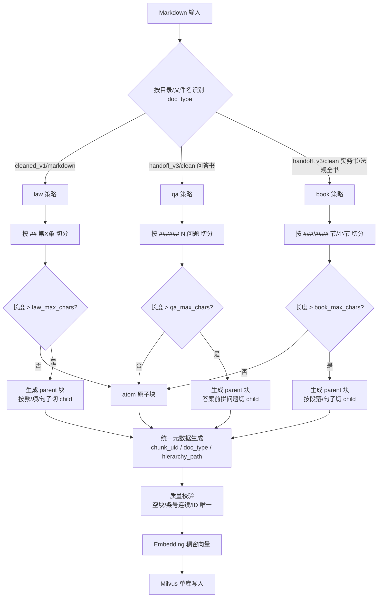

# 文本分块优化计划

> 面向 `cleaned_v1/markdown` 法规数据与 `handoff_v3/clean` 书籍/问答数据，优化文本分块 → 元数据 → 向量化入库链路，并为二期父子块预留字段与切分规则。

---

## 一、核心设计原则

1. **原子块优先**：法规以“条”、问答以“问答对”作为最小原子块，不轻易切碎。
2. **类型化路由**：按来源目录识别 `doc_type`，不同类型使用不同切分标题层级与长度阈值。
3. **超长块才二次切分**：原子块超过类型阈值后，按句子/段落边界切分，并保留上级结构信息。
4. **二期父子块就绪**：一期即使不真正启用父子块，也预留字段与 parent id，保证后续平滑升级。
5. **复用现有 Milvus 能力**：继续用 `MilvusStoreManager` 单集合存储，稠密向量 + 可选 BM25 稀疏向量 + 标量过滤。

---

## 二、分块架构流程图

---

## 三、文档类型识别与切分策略

| doc_type | 来源目录 | 切分标题层级 | 原子块阈值 | 超长块二次切分规则 |
| --- | --- | --- | --- | --- |
| `law` | `cleaned_v1/markdown` | `## 第 X 条` 章名作为层级元数据 | 600 ~ 800 字 | 优先按 `#### （一）` 款项切；无款项时按句子边界切 |
| `qa` | `handoff_v3/clean`（1200 问） | `###### N.问题` 章名作为层级元数据 | 800 ~ 1000 字 | 仅对答案部分切分，每个 child 前拼接完整问题原文 |
| `book` | `handoff_v3/clean`（实务书/法规全书） | `### 节` / `#### 一、…` | 1200 ~ 1600 字 | 按段落边界优先，段落仍超长则按句子边界切 |

> **注意**：切分前必须先处理 `## 第一条 为了规范……` 这类标题行内联正文，否则正文会随标题被丢弃。当前 `adapt_pdf_markdown` 里已有等价保护，新 chunker 需要保留。

---

## 四、Milvus 索引与集合设计

继续使用现有 `MilvusStoreManager` 的**单集合**方案，新增字段走动态字段写入。集合名可沿用现有配置（如 `public_kb`）或新建实验集合（如 `public_kb_chunked_v2`），重建时避免误删生产集合。

### 4.1 Schema 字段

| 字段名 | 类型 | 说明 |
| --- | --- | --- |
| `id` | INT64 | 主键，服务端 auto_id |
| `text` | VARCHAR(65535) | 块完整文本；开启 BM25 时启用 analyzer |
| `vector` | FLOAT_VECTOR(1024) | bge-m3 稠密向量，度量 COSINE |
| `sparse_vector` | SPARSE_FLOAT_VECTOR | 服务端 BM25 生成，仅当 `enable_bm25=true` |

### 4.2 索引配置

| 字段 | 索引类型 | 度量方式 / 参数 |
| --- | --- | --- |
| `vector` | HNSW（2026-09-08 由 IVF_FLAT 迁移） | COSINE，M=16，efConstruction=128，检索 ef=64 |
| `sparse_vector` | SPARSE_INVERTED_INDEX | BM25，k1=1.2，b=0.75 |
| `doc_type` | 标量索引（INVERTED） | 加速按类型过滤 |
| `doc_id` | 标量索引 | 加速按文档过滤 |
| `chunk_uid` | 标量索引（INVERTED） | 幂等判重查询 |

> **说明**：2026-09-08 已按本计划 §4.2 备注正式迁移 HNSW 并默认启用 BM25 关键词检索
> （详见 `docs/plan1/向量索引重构执行方案（HNSW+BM25）.md`）；IVF_FLAT 作为兼容分支保留
> 在 `core/vectorstore/index_params.py` 的分发逻辑中。

---

## 五、元数据字段清单

以下字段均写入 Milvus 动态字段。标 `*` 为与现有契约 `validate_ingestion_documents` 兼容所必需保留的字段。

| 字段名 | 类型 | 必填 | 生成规则 |
| --- | --- | --- | --- |
| `chunk_uid` | VARCHAR(64) | 是 | `ck-md5(doc_name\|chapter\|chunk_index\|text)`，用于幂等去重 |
| `doc_id` * | VARCHAR(32) | 是 | 文档唯一 ID，如 `law_001` / `qa_001` / `book_001` |
| `doc_name` * | VARCHAR(255) | 是 | 文档原名（如文件名 stem），保持与现有 `chunk_uid` 口径一致 |
| `doc_type` | VARCHAR(16) | 是 | `law` / `qa` / `book` |
| `chapter` * | VARCHAR(512) | 是 | 层级路径，等价于 `hierarchy_path`，如 `招标投标法 / 第一章 总则` |
| `hierarchy_path` | VARCHAR(512) | 是 | 完整层级路径，如 `招标投标法 / 第一章 总则 / 第一条` |
| `chunk_index` * | INT64 | 是 | 文档内块顺序号，从 0 递增 |
| `chunk_type` | VARCHAR(16) | 是 | `atom` / `parent` / `child` |
| `parent_chunk_id` | VARCHAR(64) | 否 | 子块填对应父块的 `chunk_uid`；原子块/父块留空 |
| `sequence_in_parent` | INT64 | 否 | 子块在父块内的顺序 1,2,3…；原子块/父块填 0 |
| `article_number` | VARCHAR(32) | 否 | 法规专属：如 `第一条` |
| `question` | VARCHAR(512) | 否 | 问答专属：完整问题文本 |
| `effective_date` | VARCHAR(32) | 否 | 法规施行日期，用于时效过滤 |
| `status` | VARCHAR(32) | 否 | 效力状态，如 `现行有效` |
| `embedding_model` | VARCHAR(64) | 是 | 如 `BAAI/bge-m3` |
| `schema_version` | VARCHAR(32) | 是 | 集合 schema 版本，如 `public_kb_v2` |
| `source_format` | VARCHAR(16) | 否 | `text` / `pdf` |

---

## 六、二期父子块准备规则

一期不强制启用父子块，但所有块都必须携带以下三个字段，且切分逻辑要**严格不跨边界**，为二期父块回溯打好基础。

### 6.1 三种块的默认值

| 块类型 | `chunk_type` | `parent_chunk_id` | `sequence_in_parent` |
| --- | --- | --- | --- |
| 原子块（未触发二次切分） | `atom` | 空字符串 | 0 |
| 父块（被二次切分的原始长块） | `parent` | 空字符串 | 0 |
| 子块（父块切分后的片段） | `child` | 父块的 `chunk_uid` | 1, 2, 3… |

### 6.2 不跨边界切的含义

- **法规**：子块边界只能在同一条内的款项 `####` 或句号处，不能把下一条内容带进来。
- **问答**：子块边界只能在答案内部，不能把下一个问题带进来；每个 child 开头必须带完整问题。
- **书籍**：子块边界只能在同一个小节 `####` 内部，不能跨到下一个小节。

### 6.3 二期启用时的升级路径

1. 检索默认只查 `chunk_type = atom` 或 `child`。
2. 需要上下文时，用 `parent_chunk_id` 回查父块。
3. 无需重建集合或重新分块，因为一期已经保留了所有必要字段。

---

## 七、入库执行流程

1. **类型识别**：按文件路径或文件名前缀打 `doc_type`。
2. **前置修复**：处理标题行内联正文、表格原子化。
3. **层级切分**：根据类型选择标题层级，生成原子候选块。
4. **长度 Fallback**：超长块生成 `parent` + N 个 `child`，严格不跨边界。
5. **元数据填充**：生成 `chunk_uid`、`hierarchy_path`、父子块字段、类型专属字段。
6. **质量校验**：过滤空/碎块、检查法规条号连续性、校验 `chunk_uid` 唯一性。
7. **向量化**：批量生成稠密向量，BM25 sparse 由 Milvus 服务端自动生成。
8. **Milvus 写入**：按 `chunk_uid` 幂等写入，重复导入自动跳过。

---

## 八、验收要点

- 法规类：抽查 10 部法，确认每条为独立 chunk，无正文丢失，条号连续。
- 问答类：抽查 50 个问答对，确认一问一答为一个 chunk，超长问答的子块均带问题前缀。
- 书籍类：抽查 5 章，确认小节标题作为层级元数据，长段落被合理切分。
- 幂等性：同一批文件跑两次，Milvus 向量数不变。
- 检索验证：用 10 个代表性问题检索，top 结果应落在正确 doc_type 和层级内。
