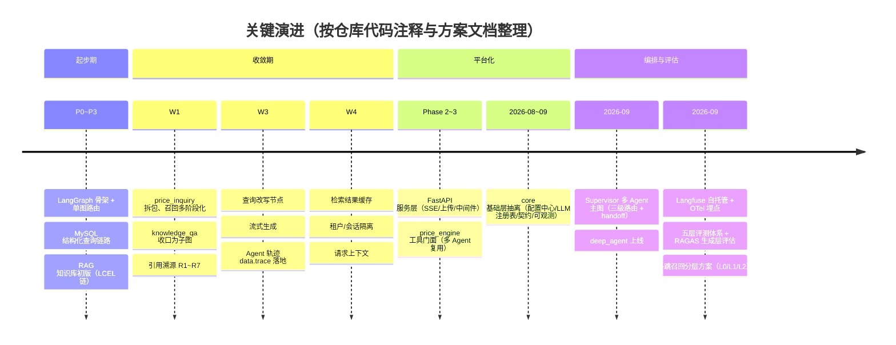
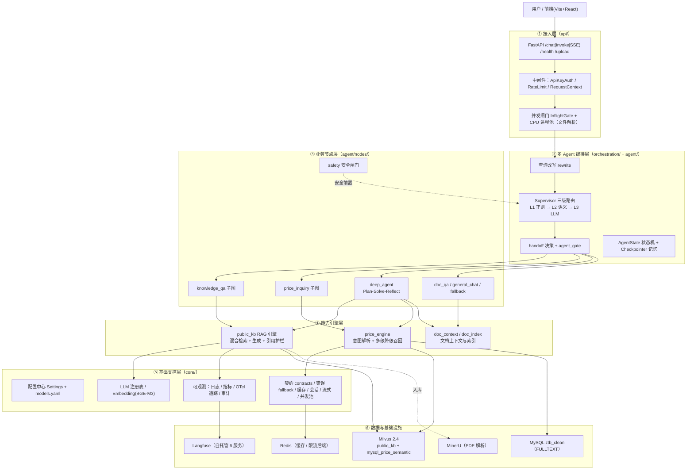
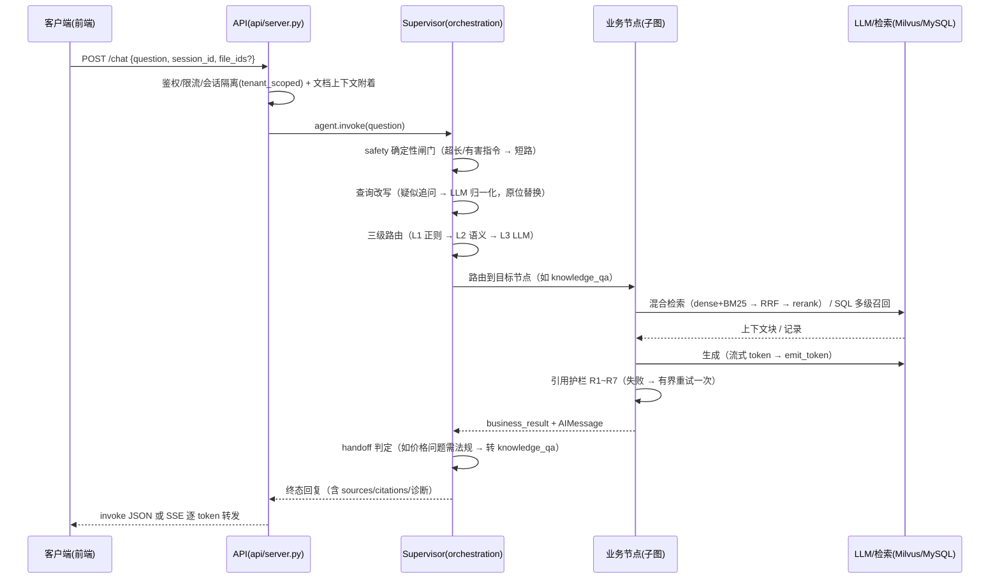
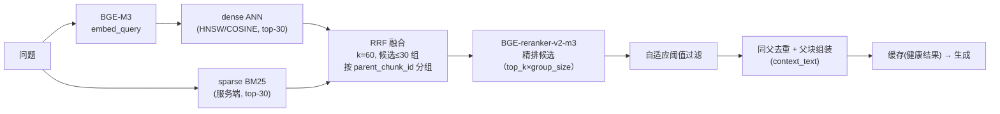
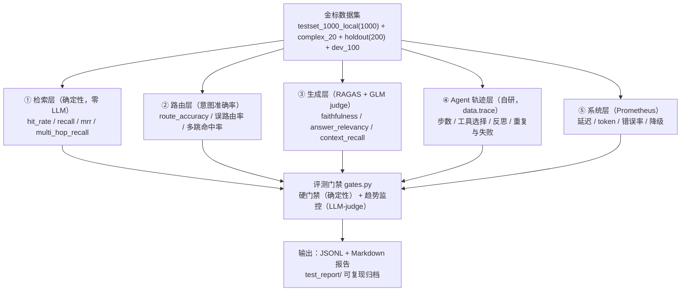

# 招投标智能助手（ZTB Demo）项目开发文档

| 项目   | 内容                                                                                          |
| ---- | ------------------------------------------------------------------------------------------- |
| 文档名称 | 招投标智能助手项目开发文档                                                                               |
| 文档版本 | v1.0                                                                                        |
| 编制日期 | 2026-09-15                                                                                  |
| 适用范围 | 后端核心系统（`agent` / `orchestration` / `public_kb` / `price_engine` / `api` / `core` / `evals`） |
| 参考基线 | 代码仓库 `D:\agent_project\ztb_demo`（当前工作区最新代码）                                                 |

> 本仓库另有
>
> `docs/project_overview.md`
>
> （架构总览，v4.0）与
>
> `docs/plan1/`
>
> （各专项方案），本文档在二者基础上按「整体架构 → 功能模块 → 技术方法 → 评估」结构重新组织，并同步了当前代码的最新演进（多 Agent 编排、可观测性、评测体系）。

---

## 1. 项目概述

### 1.1 项目背景与定位

**招投标智能助手**（Bidding Intelligent Assistant）是一个面向政府采购与招投标领域的 AI Agent 系统。它围绕招投标业务人员的真实工作场景，将**结构化数据查询**（企业工商 / 处罚 / 中标信息）、**权威法规知识库问答**（招标投标法、政府采购法等法律 PDF）、**多源交叉推理**（先查数据、再引法规）三大能力收敛到一个对话式入口，以自然语言完成 "查企业、查标讯、问法规、读文档" 等高频任务。

系统采用 **LangGraph 状态图 + 多 Agent 编排（Supervisor 模式）+ 混合检索 RAG** 的技术路线：

- **专业性强**：知识问答基于权威法规 PDF 构建 RAG 知识库，输出带来源引用（R1~R7 引用护栏）与原文溯源；
- **数据实时性**：企业信息 / 中标标讯走结构化 MySQL（`ztb_clean`）+ Milvus 语义召回，避免 LLM 幻觉编造数据；
- **多步推理**：复杂问题（"查某公司中标记录，并结合法规说明中标后不签合同的后果"）由 deep_agent 以 Plan-and-Solve 方式规划、调用工具、反思修正；
- **可观测可评估**：全链路 OTel 追踪（Langfuse）+ Prometheus 指标 + 五层评测体系（检索 / 路由 / 生成 / Agent 轨迹 / 系统），并引入 RAGAS 做生成层量化评估。

### 1.2 核心能力矩阵

| 能力             | 路由意图            | 数据 / 知识来源                                            | 技术路线                           | 状态    |
| -------------- | --------------- | ---------------------------------------------------- | ------------------------------ | ----- |
| 专业知识问答         | `knowledge_qa`  | 法规 PDF → Milvus 向量库（`public_kb` 集合）                  | 混合检索 RAG + 引用护栏 + 有界重试         | ✅ 已上线 |
| 企业 / 标讯 / 价格查询 | `price_inquiry` | MySQL `ztb_clean` + Milvus `mysql_price_semantic` 集合 | LLM 意图解析 + 多级降级召回 + 混合打分       | ✅ 已上线 |
| 深度交叉推理         | `deep_agent`    | 上述两者 + 会话文件                                          | Plan-and-Solve ReAct（规划→执行→反思） | ✅ 已上线 |
| 文档问答           | `doc_qa`        | 用户上传文件（会话级）                                          | 文档内检索（top-K）+ 全文回退             | ✅ 已上线 |
| 通用对话 / 寒暄      | `general_chat`  | 无                                                    | LLM 直答                         | ✅ 已上线 |
| 兜底 / 降级        | `fallback`      | 无                                                    | 友好提示，不阻断                       | ✅ 已上线 |
| 内容安全           | `safety`        | 无                                                    | 确定性零 LLM 闸门（超长 / 有害指令）         | ✅ 已上线 |

### 1.3 建设历程（关键演进节点）



---

## 2. 总体系统架构

### 2.1 分层架构总览

系统按「接入 → 编排 → 业务节点 → 能力引擎 → 基础支撑 → 数据基础设施」六层组织，层间通过**契约化接口**（`core/contracts`）解耦。



**各层职责一句话：** 接入层负责协议与治理（鉴权、限流、流式）；编排层决定 "这个问题交给谁"（三级路由 + 跨 Agent 转交）；业务节点层是 "能力的执行单元"（每个节点 / 子图一个专业任务）；能力引擎层沉淀可复用能力（RAG、价格查询）；基础支撑层提供配置、模型、可观测与通用组件；数据层承载向量与结构化数据。

### 2.2 核心请求链路（单轮时序）



### 2.3 设计原则

1. **契约先行**：`core/contracts` 定义 Milvus 集合契约、检索诊断（`RetrievalDiagnostics`）、轨迹载荷（`trace_payload`）等强类型接口，跨模块依赖接口不依赖实现；
2. **降级优先，永不裸奔**：所有业务节点以 `_with_fallback()` 包装，检索异常 → 纯稠密回退，LLM 异常 → 友好兜底，缓存 / Redis 异常 → 空缓存直通，保证任何依赖抖动下用户都能拿到可理解的结果；
3. **配置即代码**：`core/config/settings.py`（env 驱动）+ `core/config/profiles/models.yaml`（模型槽位）双配置中心，换模型 / 换参数零代码改动；
4. **数据驱动路由**：路由能力注册表 `agent/registry.py`（CapabilityRegistry）数据驱动，新增分支不改 router/graph 主逻辑；
5. **观测先行**：日志（JSON + request_id/session_id）、指标（Prometheus）、追踪（OTel → Langfuse）、审计四件套全覆盖，评测结果可复现（JSONL + Markdown 双写）；
6. **运行时与评测隔离**：`evals/` 为离线评测包，运行时（`core`/`agent`/`orchestration`/`api`/`price_engine`/`public_kb`）禁止 import，用守卫测试强制约束。

---

## 3. 技术栈全景

| 层次          | 选型                                    | 版本 / 规格                 | 用途                                                                |
| ----------- | ------------------------------------- | ----------------------- | ----------------------------------------------------------------- |
| 语言 / 运行时    | Python                                | 3.11                    | 后端主语言                                                             |
| 包管理         | uv                                    | latest                  | 依赖安装与虚拟环境（`uv sync --no-dev` 生产不携带 dev 依赖）                        |
| Agent 框架    | LangGraph                             | ≥1.2.11                 | StateGraph 状态机、子图、Checkpointer、条件边                                |
| LLM 框架      | LangChain Core / langchain-openai     | ≥1.5.4, <2.0.0          | Runnable 链、结构化输出、工具绑定、流式                                          |
| 向量库         | Milvus（pymilvus）                      | 2.4.x（依赖 setuptools<70） | 法规知识库 + 价格语义集合；dense HNSW + sparse BM25                           |
| 关系库         | MySQL                                 | 8.x（Docker）             | `ztb_clean` 结构化业务数据，FULLTEXT ngram（token_size=2）                  |
| 缓存 / 限流     | Redis                                 | 8.1（可选后端）               | 检索缓存 `CACHE_BACKEND=redis`、限流 `rate_limit_backend=redis`          |
| 生成 / 路由 LLM | DeepSeek（deepseek-chat）               | temperature=0.0         | 槽位：router/kb_generation/price_intent/doc_agent/deep_agent/rewrite |
| 评测判定 LLM    | 智谱 GLM                                | judge 槽位                | RAGAS 生成层判定（避免自评偏差）                                               |
| Embedding   | BGE-M3（BAAI/bge-m3）                   | 1024 维，OpenAI 兼容 API    | 文本向量化（SiliconFlow 等可切换）                                           |
| Reranker    | BGE-reranker-v2-m3                    | SiliconFlow API         | 混合检索精排                                                            |
| PDF 解析      | MinerU（MinerUParser）                  | API 服务                  | PDF → Markdown                                                    |
| 服务框架        | FastAPI + uvicorn                     | latest                  | REST + SSE 流式                                                     |
| 可观测         | OpenTelemetry + Prometheus + Langfuse | Langfuse 4.x 自托管        | span 树、指标、trace 持久化、score 仓库                                      |
| 评测          | RAGAS（dev 依赖）                         | 0.3.x                   | faithfulness /answer_relevancy/context_recall 等                   |
| 数据校验        | pydantic                              | v2                      | 请求 / 响应 / 契约模型                                                    |
| 测试          | pytest                                | latest                  | 全量回归网（基线 970 passed / 10 skipped，2026-09-09）                      |
| 前端（范围外）     | Vite + React 19 + TS + Tailwind v4    | —                       | SSE 消费端（fetch-event-source），不在本文档范围                               |

> 说明：模型槽位、索引类型（HNSW/IVF_FLAT）、检索窗口、阈值等全部集中在
>
> `core/config`
>
> 与
>
> `models.yaml`
>
> ，生产换模型 / 换参数不需要改业务代码。

---

## 4. 功能模块拆解

### 4.1 API 接入层（`api/`）

**职责**：对外协议、请求治理、流式转发。


- `server.py`**（FastAPI 工厂&#x20;**`create_app`**）**：
  - `POST /chat`：`stream=false` → invoke 返回结构化 `ChatResponse`；`stream=true` → SSE 逐 token 转发（生成节点 `.stream` 实时写 sink，端点按 token/result/error/done 事件转发）；
  - `GET /health`：agent 就绪标志；文件上传接口（CPU 密集解析在独立进程执行，避免与请求链路抢 GIL—— 实测 5 并发上传会把提问 p95 从 3.41s 拉到 6.29s，故走 `core.jobs.cpu_pool`）；
  - 会话 id：请求携带则沿用，否则随机生成（`uuid4().hex`），随响应回传；会话 / 检查点 / 文件按租户命名空间隔离（`tenant_scoped`）；
  - 文档上下文附着：显式 `file_ids` 强信号优先；否则按 `SESSION_FILE_AUTOLOAD_N` 自动附着本会话最近文件（弱信号，路由层区分强弱）；
  - 并发闸门：`InflightGate` 在飞请求打满时快速失败（`ServiceBusyError` + retry_after），保护后端不被压垮。
- **中间件（**`middleware/`**）**：`ApiKeyAuthMiddleware`（API Key 鉴权）、`RateLimitMiddleware`（Token Bucket，进程内 / Redis 双后端）、`RequestContextMiddleware`（request_id 注入日志与追踪上下文）。

### 4.2 多 Agent 编排层（`orchestration/` + `agent/`）

**职责**：决定 "这个问题交给谁"，并管理跨 Agent 转交。

- **主图（**`orchestration/main_graph.py`**）**：`START → rewrite → supervisor → 条件边 → 业务节点 → handoff_decider → 条件边（转交 / 终态 / END）`。
- **Supervisor 三级路由（**`orchestration/supervisor.py`**&#x20;+&#x20;**`routing_rules.yaml`**）**：
  - **L1 确定性正则快路径**（零 LLM 成本）：问候语 → `general_chat`；项目编号 → `price_inquiry`；文档相关模式 → `doc_qa`；命中即出，未命中下沉；
  - **L2 语义层**：轻量相似度 / 规则判定；
  - **L3 LLM 层**：调用 `router` 槽位（temperature=0，结构化输出优先，Tool Calling 兜底，带最近 3 轮上下文），失败 → `fallback`。
- **handoff 决策（**`orchestration/handoff.py`**）**：业务节点完成后判定是否需要转交 —— 如价格问题中出现「依据 / 法规 / 为什么」等关键词 → 转 `knowledge_qa` 补充法规依据；会话有文件且命中跨源关键词 → 走 `agent_gate` 抬升到 `deep_agent`。
- **路由注册表（**`agent/registry.py`**）**：`CapabilityRegistry` 数据驱动，新增分支只需注册 `CapabilitySpec`（route_desc /route_tool_doc/examples），router/graph 自动适配，**不修改** router.py/graph.py 主逻辑。
- **状态与记忆**：`AgentState(messages, router_intent, business_result)`；`messages` 用 `add_messages` reducer 按消息 id 去重合并（支撑查询改写原位替换）；`checkpointer.py` 工厂默认 `MemorySaver`，可一行切换 sqlite/postgres/redis 持久化。

### 4.3 专业知识问答模块（`public_kb/` RAG 引擎）

**职责**：法规 PDF → 知识库 → 检索 → 生成 → 引用护栏的完整 RAG 闭环。

- **离线入库（**`ingestion/`**）**：`FileIngestionPipeline` 三段式：`FormatRouter`（格式识别）→ `PdfNormalizer`（MinerU 解析归一）→ 清洗 + `SemanticChunker`（标题感知分块，2000 字符 / 块、100 字符重叠）→ `MilvusSink`（HNSW 索引入库）。知识库初始化后只读，仅支持批量导入或 `clear_kb()`。
- **在线问答（**`agent/nodes/knowledge_qa/subgraph.py`**）**：进程级锁惰性单例（settings/llm/validator/prompt）；子图流程 `retrieve → generate → guardrail（失败有界重试 ≤1 次）→ refuse/refuse_error`，共享通道 `messages/business_result` 自动合并回父图，`qa_*` 独有键不污染 AgentState。
- **检索（**`retrieval/`**）**：`HybridRetriever` 编排稠密（BGE-M3）+ 稀疏（服务端 BM25）→ RRF 融合 → BGE-reranker 精排 → 自适应阈值过滤 → 同父去重 + 父块上下文组装（详见 §5.1）。
- **生成（**`generation/`**）**：prompt 构建（系统提示 + 上下文渲染 + 行内引用开关）+ `kb_generation` 槽位生成 + 流式输出（`emit_token` 写 sink）。
- **引用护栏（**`guardrails/citations_validate.py`**）**：`CitationValidator` 对回答执行 R1~R7 规则校验（详见 §5.6），失败时生成反馈文本注入重试 prompt 重生成一次；全部规则失败或耗尽重试则按语义返回（不无限循环）。
- **拒绝策略**：检索为空 → 拒答（`refuse`）；知识库未初始化 → 引导文案（`refuse_error`）；空白 / 非法问题 → 校验异常捕获（B9）友好提示。

### 4.4 价格 / 标讯查询模块（`price_engine/`）

**职责**：自然语言 → 结构化业务查询（企业工商、处罚记录、中标项目、标讯）。

- **意图解析（**`intent.py`**&#x20;/&#x20;**`enum_norm.py`**&#x20;/&#x20;**`guards.py`**）**：LLM 统一意图解析（`_parse_unified_intent`），枚举归一化（降级为原始过滤），守卫判定（项目编号纠偏 / 注入 + 实体有效性校验）—— 守卫不通过**显式拒绝**并带 `guard_reason`，避免两条入口结果不一致（审计 C7）。
- **多级降级召回（**`recall.py`**）**：六阶段召回链：Milvus 语义召回 → OR FULLTEXT → AND FULLTEXT → LIKE 回退 → 逐关键词拆分 → 全表扫描兜底；各阶段带递减权重，混合打分后排序（详见 §5.3）。SQL 超时执行 + 回表补列 + 通用查询引擎。
- **查询路径（**`queries.py`**&#x20;/&#x20;**`sql_builders.py`**）**：按子路由分发（company_query /bidding_query/all），条件构建优先索引化精确匹配（`=`/`>=`/`<=`）与 FULLTEXT，规避 `LIKE '%…%'` 全表扫描。
- **工具门面（**`tools.py`**）**：`price_query()` / `price_query_as_tool()` 以 `StructuredTool` 暴露给多 Agent 复用（deep_agent 工具之一），带 `max_rows` 截断契约与 `total_found` 全量感知。
- **语义召回（**`semantic.py`**）**：Milvus `mysql_price_semantic` 集合承载结构化数据的语义召回，与检索链路由 `core/retrieval/pipeline.py`（`RecallPipeline`）统一编排。

### 4.5 深度推理 Agent（`agent/nodes/deep_agent.py`）

**职责**：跨数据源、跨知识域的复杂问题（多步任务）。

- **范式**：Plan-and-Solve → Observation → Reflection 循环：
  - **规划**：LLM 生成 `plan`（目标 + 步骤 + 工具 + 依赖关系）；
  - **执行**：逐步调用工具（`kb_search_tool` / `read_file` / `price_query`），记录每步 `status(ok/empty/error)`、观测摘要、耗时；
  - **反思**：`reflection {verdict: adequate/revised/gap, notes, revised_answer}`，有界轮次，必要时修订后重答；
  - **轨迹输出**：`data.trace`（plan/steps/reflection/rounds）落盘，作为 Agent 轨迹评估（E2-3）的标准输入。
- **成本控制**：规划步数与反思轮次有界；已知限制：顺序执行，EXECUTE 并行化 + 成本闸门列入后续规划（多跳方案 Layer 2）。

### 4.6 文档问答模块（`doc_qa` + `doc_context`）

**职责**：对用户上传的文档（采购合同、标书等）进行问答。

- 上传文件经 CPU 进程池解析后落 `filestore`（会话级归属校验）；
- `doc_context.context_docs()` 渲染上下文：长文档走**文档内检索**（top-K 块，`doc_index` 索引），小文档 / 未建索引 / 检索失败回退全文，节点侧据块标记区分两种模式；
- 会话文件自动附着（弱信号）与显式 `file_ids`（强信号）两级触发；路由层据此决定是否抬升 deep_agent 做跨源推理。

### 4.7 通用对话与兜底（`general_chat` / `fallback`）

- `general_chat`：寒暄、自我介绍等简单对话直答；
- `fallback`：LLM 路由失败 / 未知意图 / 业务节点异常时的统一降级出口，返回友好提示不阻断会话。

### 4.8 内容安全模块（`agent/nodes/safety.py`）

**职责**：路由前的确定性内容安全闸门（零 LLM 成本、绕过一切模型层）。

- 超长问题（> `max_question_chars`，默认 2000 字）→ 拒绝；
- 可执行有害请求（伪造 / 篡改 / 删记录 / 收买评标等动作导向关键词）→ 拒绝；**不拦**「围标串标 / 行贿受贿」等合法话题词（知识库正常覆盖的专业问题，误伤即能力受损）；
- 关键词表可经 env `SAFETY_HARMFUL_KEYWORDS` 扩展；命中 → `business_result.branch=safety` + 统一安全回复 + `safety_reason`，条件边将 `SAFETY_BLOCKED_ROUTE` 映射到 END，短路后不再进入业务节点。

### 4.9 基础支撑层（`core/`）

| 子模块              | 职责                                                                                                    |
| ---------------- | ----------------------------------------------------------------------------------------------------- |
| `config/`        | `Settings`（env 驱动全量参数）+ `models.yaml` 模型槽位（provider/model/temperature/base_url）                       |
| `llm/`           | 模型注册表 `create_llm_for_slot`，Provider 插件化（deepseek 等），换模型零代码                                           |
| `embeddings/`    | BGE-M3 服务封装（OpenAI 兼容 API，超长自动截断，模型版本契约校验）                                                            |
| `contracts/`     | Milvus 集合契约、`RetrievalDiagnostics`、`RetrievalMode`、`trace_payload`、问题校验                               |
| `errors/`        | 异常类型 + 处理器（`error_envelope` / `unhandled_envelope`）+ 图级 fallback 包装                                   |
| `observability/` | JSON 日志（request_id/session_id/tenant）、Prometheus 指标、OTel 追踪、LLM token 回调、审计、guardrail / 降级埋点（详见 §6.1） |
| `cache/`         | 版本化 TTL 检索缓存（内存 `VersionedTTLCache` / Redis `RedisBackedCache`），只缓存健康结果（防降级结果毒化缓存）                    |
| `rdb/`           | MySQL 连接池（模块级复用，无固定上限）                                                                                |
| `vectorstore/`   | Milvus 客户端 + 索引参数分发（HNSW `M/efConstruction`、IVF_FLAT `nlist`、检索 `ef/nprobe`）                          |
| `retrieval/`     | `RecallPipeline`（价格查询统一召回编排）                                                                          |
| `session/`       | 会话注册表（登记 + 惰性过期清理）                                                                                    |
| `streaming/`     | `StreamSink` / `emit_token`（生成节点流式写 sink）                                                             |
| `concurrency/`   | 线程池、CPU 进程池、`InflightGate`、Token Bucket 限流                                                            |
| `jobs/`          | `cpu_pool`（`parse_file_worker` 独立进程文件解析）                                                              |
| `protocol/`      | 回复模型 + 渲染器（`reply_to_response`）                                                                       |
| `filestore/`     | 会话级文件存储与归属校验                                                                                          |
| `doc_index/`     | 文档索引（doc_qa 文档内检索）                                                                                    |

---

## 5. 核心算法与关键技术

### 5.1 混合检索与融合排序（知识问答）

**链路**：稠密（BGE-M3 1024 维，COSINE）＋ 稀疏（Milvus 服务端 BM25）双路召回 → RRF 融合 → BGE-reranker-v2-m3 精排 → 自适应阈值过滤 → 同父去重 + 父块上下文组装。



关键参数（`core/config` 可调）：dense/sparse 各取 30 条、融合上限 30 组、`RRFRanker(k=60)`、rerank 候选窗口 `top_k×group_size`、最终截断 `retrieval_top_k`（多跳优化后默认 11）。

### 5.2 自适应阈值过滤（`strategies.py`）

基于 reranker 最高分动态决定过滤阈值（避免固定阈值在高低置信场景下双输）：

| 最高相关度（top1） | 置信档  | 过滤阈值                      |
| ----------- | ---- | ------------------------- |
| ≥ 0.75      | 高置信  | 0.40（放宽，允许低分 chunk 补充上下文） |
| ≥ 0.50      | 中等置信 | 0.45                      |
| < 0.50      | 低置信  | 0.50（实际由拒答判定决定是否回答）       |

参数有 [0,1] 区间与单调性校验，非法配置直接抛错，防止静默失效。

### 5.3 多级降级召回与混合打分（价格查询，`price_engine/recall.py`）

六阶段召回按可用性逐级降级，每阶段带**阶段权重**，最终 `混合分 =（MySQL 相关度 + 向量分×2 + 语义关键词分×权重）× 阶段权重`：

| 阶段 | 召回方式                                | 权重   |
| -- | ----------------------------------- | ---- |
| 0  | Milvus 语义召回（`mysql_price_semantic`） | 1.08 |
| 1  | OR FULLTEXT                         | 1.00 |
| 2  | AND FULLTEXT                        | 0.92 |
| 3  | LIKE 回退                             | 0.82 |
| 4  | 逐关键词拆分                              | 0.72 |
| 5  | 全表扫描兜底                              | 0.55 |

- 排序为金额 / 时间维度时关键词权重降为 0.3（避免排序意图被关键词打分带偏）；
- 每阶段执行带 SQL 超时与耗时 profile（`[SQL_PROFILE]` 日志）；守卫不通过时显式拒绝而非无脑查全表。

### 5.4 三级意图路由（Supervisor）

```
L1 正则快路径（零 LLM）──命中──► 直出目标

&#x20;     │未命中

L2 语义层 ──命中──► 直出目标

&#x20;     │未命中

L3 LLM 路由（temperature=0，结构化输出优先，Tool Calling 兜底）

&#x20;     │失败

&#x20;  fallback（友好降级）
```

- 路由分类模型采用 `with_structured_output(RouterDecision)` 优先、Tool Calling 回退的双保险；
- 携带最近 3 轮对话上下文做语境感知路由；全部失败 → `fallback`；
- 能力清单（`registry.py` CapabilitySpec）数据驱动，路由提示词与示例随注册表演进，无需改 router 代码。

### 5.5 多跳召回分层方案（L0 / L1 / L2）

**问题**：多跳问题（答案分布在 ≥2 个块）第二块进不了上下文。实测 top-5 窗口下双段全中仅 0.3714（35 条多跳只有 37% 两段都进 top-5）；根因是**窗口太窄**（fusion 30 组候选只有前 10 组进 rerank、前 5 组进上下文）与**文本预判不可行**（multi 中 34% 单问号、single 中 40% 双问号，文本判据天花板约 73%）。

**方案**（三层叠加，由浅入深）：

| 层           | 内容                                                              | LLM 成本    | 效果（dev_100 多跳 35 条实测）                            |
| ----------- | --------------------------------------------------------------- | --------- | ------------------------------------------------ |
| **Layer 0** | 检索窗口放宽 `retrieval_top_k` 5→11                                   | 零         | 双段全中 0.3714→0.4286，MRR 不降                        |
| **Layer 1** | knowledge_qa 检索层「证据检查 + 按需补充检索」（`kb_search_expanded`：基线 + 子句并集） | 0~1 次 / 题 | 双段全中 0.4286→**0.6000**（holdout）                  |
| **Layer 2** | deep_agent 分解（EXECUTE 并行化 + 成本闸门）                               | 仅确认多原子的问题 | 全链路 recall 0.7429 / 双段全中 0.5143 / 15.8s（成本高，不全量） |


**核心思想**：把 "要不要多块" 的决策从**文本预判**（必输）挪到**检索证据**（可观测）——L0 放宽窗口让第二块有机会进来，L1 第一轮证据不足就按缺口方向补检，L2 只服务真正拆得出的多原子问题。

### 5.6 引用溯源护栏 R1~R7（`guardrails/citations_validate.py`）

| 规则 | 名称            | 判定                           |
| -- | ------------- | ---------------------------- |
| R1 | chunk_id 完整性  | 每条引用必须携带 Milvus 行级 chunk_id  |
| R2 | chunk_uid 完整性 | 每条引用必须携带内容派生稳定标识 chunk_uid   |
| R3 | 数据源位置可定位      | doc_name/chapter 非空且非占位值     |
| R4 | 原文片段完整        | 每条引用携带非空完整原文                 |
| R5 | 上下文完整性        | 进入上下文的所有 chunk 都被引用（无遗漏）     |
| R6 | 引用标记有效性       | 【来源 N】标记全部解析到有效引用，无错误关联      |
| R7 | 上下文全标记（严格模式）  | 上下文 chunk 必须全部被回答标记引用（可配置启停） |

- 规则集可经 `CitationRuleConfig` 启停；护栏失败 → 结构化失败报告 → 反馈注入重试 prompt 重生成（有界 ≤1 次）；
- 拒答场景（`is_refusal=True`）允许引用为空；
- 配套 `scripts/run_knowledge_citation_eval.py`：基于 `testset_knowledge.jsonl`（约 106 条知识类问题）做全量引用溯源评估（逐条校验 + Milvus 回查关联），输出 JSONL + 汇总报告。

### 5.7 查询改写与指代消解（`agent/nodes/rewrite.py`）

- 挂在图入口（single 与 supervisor 都从它开始），在路由 / 业务之前运行；
- **确定性预判** `looks_like_followup`：仅在疑似追问（含「那 / 这 / 它 / 换 / 继续 / 上述」等指代线索）时花费一次轻量 LLM 调用，自包含问题零成本直通；
- 改写结果**原位替换**最后一条用户消息（同 message id，`add_messages` 按 id 合并），router 与所有业务节点看到的都是归一化问题；
- **失败软降级**：任何异常 → 原样返回，不阻断本轮；已知限制：纯省略式追问（"有没有不良记录？"）暂不命中，避免误判。

### 5.8 内容安全确定性闸门（`agent/nodes/safety.py`）

- 零 LLM、确定性、绕过一切模型层；超长（>2000 字）与动作导向有害指令双规则；
- 采用**动作导向**关键词（"帮我伪造…/ 删掉处罚记录 / 篡改…"），不拦合法话题词；
- `with_safety_gate` 装饰器挂在路由节点入口，不改变图拓扑（无新状态键、无新边），命中短路直接回安全回复并记录 guardrail 指标。

### 5.9 知识库入库管道（`public_kb/ingestion/`）

```
PDF 目录 → FormatRouter → PdfNormalizer(MinerU→Markdown) → TextCleaner

&#x20;       → SemanticChunker(标题感知, 2000字符/块, 100重叠)

&#x20;       → MilvusSink(HNSW dense + BM25 sparse, COSINE)

&#x20;       → 入库报告(chunk\_count / inserted\_count / failed 清单)
```

- 知识库初始化后只读（仅批量导入或 `clear_kb()`）；Embedding 配置与集合约定强校验（换模型 / 维度必须重建集合，否则旧向量空间被新查询向量污染）；
- 入库管道与 CLI 入库共用同一条 `FileIngestionPipeline`，保证口径一致。

### 5.10 缓存与降级策略（`core/cache/` + 各层 fallback）

- **检索缓存**：版本化 TTL（key 前缀含版本，升级即失效）；同一归一化问题命中同一条缓存；**只缓存健康结果**—— 降级结果（hybrid_error / 集合缺失）不入缓存，避免把问题 "毒化" 到 TTL 过期（实测踩过的坑，代码有注释记录）；
- **降级矩阵**：混合检索异常 → 纯稠密检索（记录 `fallback_reason` 与指标）；Reranker 失败 / 无结果 → 保留 RRF 排序（不构造虚假分数）；Redis 缓存 / 限流不可用 → 进程内直通；LLM 超时 → 图级 fallback → 兜底话术；文件解析失败 → 回退全文。

---

## 6. 可观测性与 Agent 链路评估

### 6.1 可观测性架构（`core/observability/`）

| 组件     | 实现             | 能力                                                                                                                                |
| ------ | -------------- | --------------------------------------------------------------------------------------------------------------------------------- |
| 结构化日志  | `logging.py`   | JSON 日志，上下文携带 request_id /session_id/tenant（`W2-2` 会话 id 进日志）                                                                     |
| 指标     | `metrics.py`   | Prometheus `/metrics`：分支 / 节点耗时、LLM 调用耗时与 token、guardrail 失败、检索降级（`record_recall_fallback`）、检索上下文埋点（候选数 / 返回数 / 拼接父块数 / 总字符 / 耗时） |
| 链路追踪   | `tracing.py`   | OTel span 树（`span` / `set_span_attrs` / `tag_current_span`），`router → 节点 → LLM → 检索` 成树；根 span 由中间件创建并补会话关联（E4）                   |
| LLM 回调 | `callbacks.py` | 每次 LLM 调用的耗时 /token 自动埋点（slot+model 维度）                                                                                           |
| 审计     | `audit.py`     | 关键动作审计记录                                                                                                                          |
| 上下文    | `context.py`   | `set_session_id` / `tenant_scoped` 上下文传播（含 SSE 线程路径验证）                                                                            |

### 6.2 Langfuse 自托管部署（`deploy/langfuse/`）

官方 compose 原样保留 6 服务，本地开发即用、生产可整体迁移 Linux：

| 服务              | 作用                        | 端口        |
| --------------- | ------------------------- | --------- |
| langfuse-web    | 控制台 / API                 | 3000（对外）  |
| langfuse-worker | 异步摄取与评测执行                 | 3030      |
| postgres        | 元数据（组织 / 项目 / 数据集 /score） | 5432      |
| clickhouse      | trace/span 事件存储           | 8123/9000 |
| redis           | 摄取队列                      | 6379      |
| minio           | 事件与媒体 blob                | 9090/9091 |

数据全部 named volume（规避 Windows/WSL2 跨文件系统 I/O 慢）；`LANGFUSE_INIT_*` 首次启动自动建组织 / 项目 / 用户并下发 API Key。指标**双写**：Langfuse score（在线看板）+ 本地 JSONL（离线可复现、可 git 归档）。

### 6.3 评测体系总览（五层）

评测遵循「观测先行 → 标尺先行 → 度量 → 门禁 → 闭环」原则，离线包 `evals/`（datasets → runners → metrics → gates → report）与运行时完全隔离。



### 6.4 检索层评估结果（确定性指标）

数据集：holdout 200 条、top_k=11（`retrieval_layer_gate_20260910_224225.json`）：

| 口径     | 指标                     | L0（放宽窗口前） | L1（补检）     | Δ             |
| ------ | ---------------------- | --------- | ---------- | ------------- |
| multi  | multi_hop_recall（双段全中） | 0.4429    | **0.6000** | +0.1571       |
| multi  | recall                 | 0.6929    | **0.7857** | +0.0928       |
| multi  | mrr                    | 0.8390    | **0.8413** | +0.0023       |
| multi  | hit_rate               | 0.9429    | **0.9714** | +0.0285       |
| single | recall / hit_rate      | 0.9308    | **0.9462** | +0.0154       |
| single | mrr                    | 0.8442    | 0.8417     | -0.0025（基本持平） |

门禁判定（`evals/gates.py`）：multi 双段全中 ≥ 0.60（实测 0.6000 ✅）、recall ≥ 0.78（实测 0.7857 ✅）、multi MRR 不降（0.8413 ≥ 0.8390 ✅）。**检索层门禁全部达标。**

### 6.5 路由层评估结果（意图准确率）

数据集 `testset_1000_local.jsonl` + `complex_20.jsonl`，1020 样本：

| 指标               | 值                            | 门禁基准  | 判定    |
| ---------------- | ---------------------------- | ----- | ----- |
| route_accuracy   | **0.8363**（853/1020）         | —     | —     |
| single_hop 误路由率  | 0.0677（6.77%）                | < 5%  | ❌ 未达标 |
| multi_hop 命中率    | 0.6543（229/350 进 deep_agent） | ≥ 80% | ❌ 未达标 |
| complex（20 题）命中率 | **1.0**                      | ≥ 80% | ✅     |

- 混淆矩阵 top：knowledge_qa→knowledge_qa 604、deep_agent→deep_agent 249、deep_agent→knowledge_qa 118（多跳漏检）、knowledge_qa→deep_agent 44（单跳误入）、deep_agent→doc_qa 3、knowledge_qa→fallback 2；
- 独立 router 金标（36 条、覆盖 6 意图）：accuracy **0.8889**（32/36）；
- **缺口归因**（多跳方案文档）：multi 中 34% 文本上只有一个问号、single 中 40% 文本上是双问号，"问题文本结构" 与 "答案落几块" 在 1/3 以上样本错位，**任何基于文本的路由判据天花板约 73%**—— 这正是 Layer 1 检索证据补检与 deep_agent 成本闸门要解决的方向。

### 6.6 Agent 轨迹层评估结果（deep_agent，E2-3）

自研确定性指标，输入 `data.trace`（零 LLM 判定）。最新一次全量运行（56 样本，`agent_trace_20260913_223310`）：

| 指标      | 值                                                |
| ------- | ------------------------------------------------ |
| 平均规划步数  | 1.18（多步 ≥2 占 48.2%）                              |
| 工具使用频次  | kb_search_tool 33 / read_file 27 / price_query 6 |
| 步骤状态    | ok 60 /empty 6（失败 0）                             |
| 反思结论    | revised 15 / adequate 12                         |
| 重复调用样本  | 0 / 56                                           |
| 失败步样本   | 0 / 56                                           |
| 端到端耗时均值 | 5895 ms                                          |

金标对照（弱标注样本 3 条）：工具选择 precision 1.0 /recall 0.6667 / F1 0.7778，全覆盖率 33.3%（期望工具集合未全覆盖，主要缺口在 multi_hop 类问题的工具组合）。

### 6.7 系统层评估结果（进程内 Prometheus，E2-4）

| 维度                  | 次数 | 均值 (ms) | p50(ms) | p95(ms) |
| ------------------- | -- | ------- | ------- | ------- |
| branch=knowledge_qa | 19 | 7602.3  | 7375.0  | 10000.0 |
| branch=?（整体）        | 40 | 561.1   | 5.0     | 2300.0  |
| LLM router          | 20 | 1121.0  | 1500.0  | 2400.0  |
| LLM kb_generation   | 19 | 1939.5  | 1838.2  | 3812.5  |

token 消耗：kb_generation prompt 79501 /completion 5287；router prompt 22268 /completion 1441。错误与降级：LLM 失败 1 次（router），护栏失败 0，检索降级 0。门禁：LLM 错误率 ≤5%（✅）、knowledge_qa 分支均值 ≤15s（✅）。

### 6.8 评测门禁机制（`evals/gates.py`）

| 层   | 门禁                         | 基准（E2 实测校准 + 余量）                       |
| --- | -------------------------- | -------------------------------------- |
| 检索层 | multi 双段全中 /recall/ MRR 不降 | ≥0.60 / ≥0.78 / 不降（绝对口径留余量，相对口径用 "不降"） |
| 生成层 | RAGAS 三层指标 Δ（L1 vs L0）     | Δ ≥ -0.02（"扩窗不稀释"）                     |
| 系统层 | LLM 错误率 /knowledge_qa 分支均值 | ≤5% / ≤15s                             |

设计要点：**确定性指标进硬门禁，LLM-judge 指标进趋势监控**（judge 有波动，不得让 CI 抖动）；未达标不阻断交付但必须记录缺口与归因。

---

## 7. 基于 RAGAS 的 RAG 链路评估

### 7.1 评估方法

- **数据集**：dev_100（100 条，single_hop 65 /multi_hop 35，字段 question/reference/ground_truth_chunk_ids/ground_truth_text/query_type）；
- **分层对比**：Layer 0（检索窗口 top-11） vs Layer 1（证据检查 + 按需补检），评估 "扩窗 / 补检" 是否稀释生成质量；
- **指标**：`faithfulness`（忠实度，回答是否忠于检索上下文）、`answer_relevancy`（回答相关性）、`context_recall`（上下文召回，金标答案覆盖度）；
- **模型分工**：生成用 DeepSeek（kb_generation 槽位，temperature=0），**判定用智谱 GLM（judge 槽位）**—— 避免生成与判定同模型的自评偏差；判定模型与版本写入报告元数据，跨 judge 模型的分数不可直接比较；
- **判定口径**：`retrieved_contexts` = 该层实际喂给生成 LLM 的块正文；`reference` = 金标参考答案；配对 delta 仅对同题两测都出分的样本（NaN 不计入）。

### 7.2 分层结果（S1，100 题配对，2026-09-10）

| 指标                     | Layer0 (top-11) | Layer1 (补检) | Δ(L1-L0)    | 变差 / 不变 / 变好 | 配对 n |
| ---------------------- | --------------- | ----------- | ----------- | ------------ | ---- |
| 忠实度 faithfulness       | 0.8073          | **0.8860**  | **+0.0550** | 6/17/11      | 34   |
| 回答相关性 answer_relevancy | 0.7362          | **0.7679**  | **+0.0317** | 44/12/44     | 100  |
| 上下文召回 context_recall   | 0.8603          | **0.8862**  | **+0.0258** | 3/86/11      | 100  |

**三项指标在 Layer 1（补检）下全部正向提升，Δ 均 ≥ -0.02，生成层门禁通过**—— 扩窗与补检没有稀释生成质量。

### 7.3 按 query_type 分桶

| query_type | n  | 指标               | L0     | L1         |
| ---------- | -- | ---------------- | ------ | ---------- |
| multi_hop  | 35 | faithfulness     | 0.8462 | **0.9544** |
|            |    | answer_relevancy | 0.6206 | 0.6215     |
|            |    | context_recall   | 0.7452 | **0.7814** |
| single_hop | 65 | faithfulness     | 0.7958 | **0.8599** |
|            |    | answer_relevancy | 0.7985 | **0.8468** |
|            |    | context_recall   | 0.9223 | **0.9426** |


**洞察**：multi_hop 的忠实度提升最显著（+0.108），验证了 Layer 1 补检把第二块证据送进上下文后生成侧确实 "更有依据"；multi_hop 的 answer_relevancy 仍偏低（~0.62），是后续重点优化方向（答案覆盖不全 / 表述偏移）。

### 7.4 结论

1. RAG 生成链路在扩窗 + 补检方案下**质量不降反升**，L1 方案可安全全量开启；
2. 忠实度（0.886）与上下文召回（0.886）处于良好水平，幻觉控制有效；
3. 相关性（0.768）与 multi_hop 相关性（0.62）是当前最大短板，与检索层 multi recall（0.7857）联诊，方向为：补检触发信号调优、deep_agent 分解只服务真多原子问题、答案表述对齐金标。

---

## 8. 测试与质量保障

| 项      | 说明                                                                                                                                                                                         |
| ------ | ------------------------------------------------------------------------------------------------------------------------------------------------------------------------------------------ |
| 全量回归   | pytest 全量基线 **970 passed / 10 skipped**（2026-09-09，评测计划记录），任何依赖变更须复跑                                                                                                                       |
| 测试分类   | 诊断 / 剖析脚本（`db_explorer` / `explain_sql` / `profile_node_price` / `create_fulltext_indexes`）+ pytest 兼容测试（recall 优化、sub-route 分类、bug 修复回归、P0 修复验证、引用溯源 R1~R7 校验规则、**运行时禁 import evals 守卫**） |
| 金标评测   | RAG 金标（1000 条）、router 金标（36 条）、price 金标（`price_golden_final.json`）、agent 金标（`eval/agent_golden_set.json` 人工复核工具序列）                                                                         |
| 知识引用评估 | `run_knowledge_citation_eval.py`（约 106 条知识类问题，R1~R7 全量 + Milvus 回查关联）                                                                                                                      |
| 质量工具   | ruff（lint）、`.pytest_cache` / `.ruff_cache` 在库，`test_report/` 归档评估产物                                                                                                                        |
| 交付前自检  | 交付前回读产物、抽样重算关键数据、核对页数 / 条目数口径与需求一致                                                                                                                                                         |

---

## 9. 部署与运维

### 9.1 基础设施（Docker Compose）

| 组件       | 启动命令                                                                                             | 说明                                      |
| -------- | ------------------------------------------------------------------------------------------------ | --------------------------------------- |
| Milvus 栈 | `docker compose -f milvus/docker-compose.yml up -d`                                              | Milvus standalone + etcd + MinIO + Attu |
| MySQL    | `docker compose -f docker/mysql/docker-compose.yml up -d`                                        | `ztb_clean` 结构化数据（可选）                   |
| Langfuse | `docker compose --project-directory deploy/langfuse -f deploy/langfuse/docker-compose.yml up -d` | 观测 / 评测平台（6 服务，named volume）            |
| MinerU   | 独立 API 服务                                                                                        | PDF 解析（入库期使用）                           |

### 9.2 环境与配置

- `.env`（不入库，含真实 API Key）：LLM/Embedding/Reranker 密钥与 base_url、Milvus/MySQL/Redis 连接、各开关（`enable_effective_filter` / `kb_light_decompose` / `kb_guardrail_retry` / `retrieval_group_by_parent` / `CACHE_BACKEND` / `rate_limit_backend` / `CORS_ORIGINS` 等）；
- 模型槽位在 `core/config/profiles/models.yaml`，换模型零代码；
- 生产迁移：Langfuse 目录整体搬到 Linux 服务器 `docker compose up -d` 即可；`uv sync --no-dev` 生产安装不含 ragas 等 dev 依赖。

### 9.3 常用命令

```
python -m api.server                 # 启动 API（uvicorn，默认 127.0.0.1:8000）

python -m agent --question "..."     # 单轮问答（single 模式）

python -m agent --interactive        # 交互会话（clear=重置历史）

python -m public\_kb --init --pdf-dir raw\_pdfs   # 初始化知识库（一次性）

python -m pytest test/ -v            # 全量回归
```


---

## 10. 已知限制与后续规划

| # | 限制 / 缺口                             | 现状证据                     | 后续方向                                  |
| - | ----------------------------------- | ------------------------ | ------------------------------------- |
| 1 | 路由层 multi_hop 命中率 65.4%（<80%）       | 1020 样本评测；文本判据天花板～73%    | Layer 1 补检信号调优、deep_agent 成本闸门、路由金标扩展 |
| 2 | deep_agent 成本高                      | 全链路 15.8s / 题、固定 3 次 LLM | EXECUTE 并行化 + 仅确认多原子问题才分解             |
| 3 | multi_hop answer_relevancy 偏低（0.62） | RAGAS 分桶                 | 答案表述对齐金标、补检上下文精排                      |
| 4 | 文档问答依赖上传文件，无持久知识库                   | doc_qa 现为会话级             | 文档入库为企业级知识库、长期记忆                      |
| 5 | 纯省略式追问不触发改写                         | rewrite 预判只认指代线索词        | 按 golden 数据扩展预判，避免误判                  |
| 6 | R7 严格模式（上下文全标记）按配置启停                | 引用护栏可配置                  | 稳定后逐步收紧默认值                            |
| 7 | 评测依赖本地基础设施（Milvus/MySQL）            | 离线评测包已隔离                 | CI 化（门禁脚本进流水线）                        |

---

## 附录 A：关键术语

| 术语            | 说明                                              |
| ------------- | ----------------------------------------------- |
| Supervisor 模式 | 以「路由 + 转交」方式组织多个专业 Agent 的编排架构                  |
| RRF           | Reciprocal Rank Fusion，多路召回排名融合算法（k=60）         |
| HNSW / BM25   | Milvus 稠密向量图索引 / 稀疏全文检索索引                       |
| RAGAS         | 生成式 RAG 评估框架（faithfulness 等指标）                  |
| data.trace    | deep_agent 的 plan/steps/reflection 轨迹载荷（轨迹评估输入） |
| holdout       | 留出集（200 条），永不参与调参，仅做最终验证                        |
| L0/L1/L2      | 多跳召回三层方案：放宽窗口 / 证据补检 /deep_agent 分解             |

## 附录 B：参考材料索引

- 架构总览：`docs/project_overview.md`（v4.0）
- 评测与可观测性：`docs/plan1/评测与可观测性/评测与可观测性执行计划.md`、`多跳召回解决方案.md`
- 评测产物：`test_report/unified_eval_report.md`、`retrieval_layer_gate_*.json`、`ragas_s1_20260910_144219/report.md`、`agent_trace_20260913_223310/report.md`、`system_metrics_20260911_065232/report.md`
- 部署：`deploy/langfuse/README.md`、`milvus/docker-compose.yml`
- 专项方案：`docs/plan1/RAG 检索链路优化方案（修订版·可执行）.md`、`文本分块优化执行方案（修订版）.md`、`向量索引重构执行方案（HNSW+BM25）.md`
