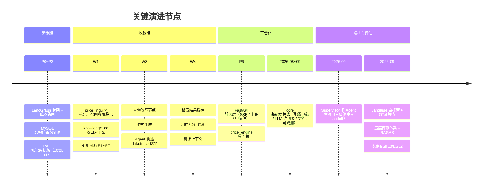
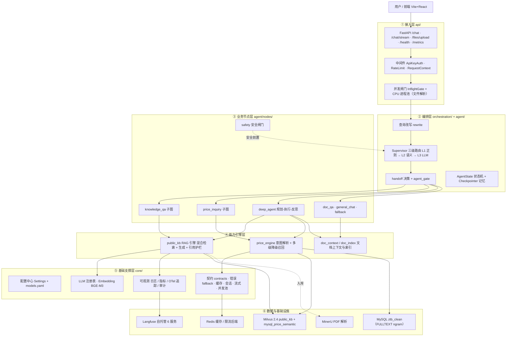
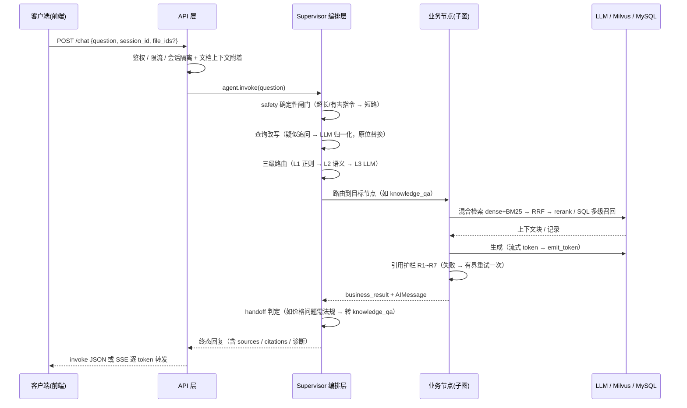
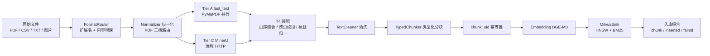
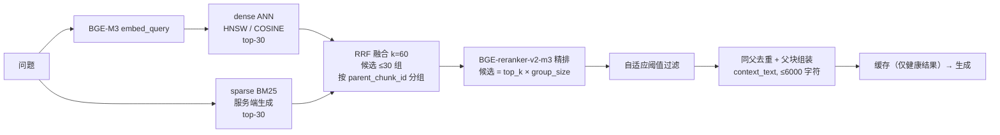
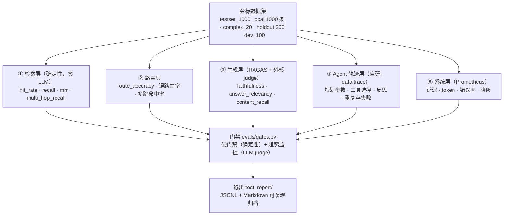

# 招投标智能助手 — 项目开发文档

| 项目 | 内容 |
| :--- | :--- |
| 文档名称 | 招投标智能助手项目开发文档 |
| 文档版本 | v2.0 |
| 编制日期 | 2026-09-16 |
| 文档状态 | 评审稿 |
| 密级 | 内部公开 |
| 适用范围 | 后端核心系统：`api` / `orchestration` / `agent` / `public_kb` / `price_engine` / `core` / `evals` |
| 参考基线 | 代码仓库 `D:\agent_project\ztb_demo`（当前工作区最新代码，2026-09-16） |
| 编制 | _待填写_ |
| 审核 | _待填写_ |
| 批准 | _待填写_ |

> 本仓库另有 `docs/project_overview.md`（架构总览 v4.0）与 `docs/plan1/`（各专项方案）。本文档在二者基础上按「**整体架构 → 功能模块 → 技术方法 → 数据架构 → 评估体系**」结构重新组织，并以**当前代码为准**校正了历史文档中与实现不一致的描述。

---

## 修订记录

| 版本 | 日期 | 修订说明 | 修订人 |
| :--- | :--- | :--- | :--- |
| v2.0 | 2026-09-16 | 按代码重写。① 新增「数据架构」「接口说明」「非功能性设计」「技术选型决策」章节；② 校正入库与分块链路（三档 PDF 路由、`TypedChunker` 类型化分块）与检索参数（`top_k=11`、HNSW、服务端 BM25）；③ 评估数据同步至 `test_report/` 最新产物；④ 统一图文与表格表达 | 项目组 |
| v1.0 | 2026-09-15 | 首版，建立「架构—模块—算法—评估」四段式框架 | 项目组 |

---

## 目录

1. [项目概述](#1-项目概述)
2. [总体系统架构](#2-总体系统架构)
3. [技术栈全景](#3-技术栈全景)
4. [功能模块拆解](#4-功能模块拆解)
5. [核心算法与技术方法](#5-核心算法与技术方法)
6. [数据架构](#6-数据架构)
7. [可观测性体系](#7-可观测性体系)
8. [Agent 链路评估体系](#8-agent-链路评估体系)
9. [基于 RAGAS 的 RAG 链路评估](#9-基于-ragas-的-rag-链路评估)
10. [接口说明](#10-接口说明)
11. [非功能性设计](#11-非功能性设计)
12. [测试与质量保障](#12-测试与质量保障)
13. [部署与运维](#13-部署与运维)
14. [已知限制与演进规划](#14-已知限制与演进规划)
15. [附录](#15-附录)

---

## 1. 项目概述

### 1.1 背景与定位

**招投标智能助手**（Bidding Intelligent Assistant）是面向政府采购与招投标领域的 AI Agent 系统。它把招投标业务人员的三类高频需求收敛到一个对话式入口：

- **查数据** —— 企业工商、行政处罚、中标标讯、历史价格等结构化信息；
- **问法规** —— 招标投标法、政府采购法等权威法规的知识问答；
- **做交叉推理** —— 先查数据、再引法规的多步综合问题。

系统采用 **LangGraph 状态图 + Supervisor 多 Agent 编排 + 混合检索 RAG** 的技术路线，四个核心特征：

| 特征 | 实现方式 | 业务价值 |
| :--- | :--- | :--- |
| 专业性强 | 权威法规 PDF 构建 RAG 知识库，输出带来源引用与原文溯源（R1~R7 引用护栏） | 结论可追溯、可审计，满足政务场景合规要求 |
| 数据可核验 | 企业/标讯走结构化 MySQL（`ztb_clean`）+ Milvus 语义召回，不靠 LLM 记忆 | 避免幻觉编造金额、日期、企业名等关键事实 |
| 多步推理 | `deep_agent` 以 Plan-and-Solve 方式规划、调工具、反思修正 | 覆盖"查某公司中标记录，并说明中标后不签合同的后果"类复合问题 |
| 可观测可评估 | 全链路 OTel 追踪 + Prometheus 指标 + 五层评测体系 + RAGAS 生成层评估 | 质量可量化、回归可门禁、问题可归因 |

### 1.2 核心能力矩阵

| 能力 | 路由意图 | 数据 / 知识来源 | 技术路线 | 状态 |
| :--- | :--- | :--- | :--- | :--- |
| 专业知识问答 | `knowledge_qa` | 法规 PDF → Milvus `public_kb` 集合 | 混合检索 RAG + 引用护栏 + 有界重试 | ✅ 已上线 |
| 企业 / 标讯 / 价格查询 | `price_inquiry` | MySQL `ztb_clean` + Milvus `mysql_price_semantic` | LLM 意图解析 + 多级降级召回 + 混合打分 | ✅ 已上线 |
| 深度交叉推理 | `deep_agent` | 上述两者 + 会话文件 | Plan-and-Solve + Reflection | ✅ 已上线（需 `CAPABILITY_ENABLED` 开启） |
| 文档问答 | `doc_qa` | 用户上传文件（会话级） | 文档内检索 top-K + 全文回退 | ✅ 已上线 |
| 通用对话 / 寒暄 | `general_chat` | 无 | 静态回复，不调用 LLM | ✅ 已上线 |
| 兜底 / 降级 | `fallback` | 无 | 友好提示，不阻断会话 | ✅ 已上线 |
| 内容安全 | `safety` | 无 | 确定性零 LLM 闸门（超长 / 有害指令） | ✅ 已上线 |

> **说明**：`deep_agent` 在 `agent/registry.py` 中默认声明为 `enabled=False`（预留能力），生产环境通过环境变量 `CAPABILITY_ENABLED=deep_agent` 开启。该机制允许在不动代码的前提下灰度新能力。

### 1.3 建设历程



---

## 2. 总体系统架构

### 2.1 分层架构总览

系统按「**接入 → 编排 → 业务节点 → 能力引擎 → 基础支撑 → 数据基础设施**」六层组织，层间通过 `core/contracts` 定义的强类型契约解耦。



**各层一句话职责**

- **接入层**：协议与治理（鉴权、限流、流式、并发保护）；
- **编排层**：决定"这个问题交给谁"（三级路由 + 跨 Agent 转交）；
- **业务节点层**：能力的执行单元（每个节点/子图一个专业任务）；
- **能力引擎层**：可复用能力沉淀（RAG、价格查询、文档索引）；
- **基础支撑层**：配置、模型、可观测与通用组件；
- **数据层**：向量与结构化数据承载。

### 2.2 核心请求链路



### 2.3 代码仓库结构

| 目录 | 职责 | 关键子模块 |
| :--- | :--- | :--- |
| `api/` | FastAPI 服务层：REST + SSE、中间件、文件上传 | `server.py`、`middleware/`、`routes/` |
| `orchestration/` | Supervisor 多 Agent 主图、路由规则、跨 Agent 转交 | `main_graph.py`、`supervisor.py`、`routing_rules.yaml`、`handoff.py` |
| `agent/` | LangGraph 节点、能力注册表、子图、护栏 | `registry.py`、`graph.py`、`router.py`、`nodes/`、`guardrails/` |
| `public_kb/` | RAG 引擎：入库管道、检索、生成、引用护栏 | `ingestion/`、`retrieval/`、`generation/`、`guardrails/`、`services/` |
| `price_engine/` | 价格/标讯查询引擎（可被多 Agent 复用的工具门面） | `intent.py`、`recall.py`、`sql_builders.py`、`semantic.py`、`tools.py` |
| `core/` | 基础支撑层：配置、LLM、可观测、契约、缓存、并发 | `config/`、`llm/`、`observability/`、`contracts/`、`cache/`、`vectorstore/` |
| `evals/` | 离线评测包（**运行时禁止 import**） | `datasets/`、`runners/`、`metrics/`、`gates.py`、`report.py` |
| `scripts/` | 评测入口、运维脚本、报告生成 | `run_*.py`、`report_*.py` |
| `test/` | 单元测试、回归测试、诊断脚本 | `test_*.py`、`legacy/`（归档） |
| `deploy/` | 部署编排（Langfuse 等） | `langfuse/docker-compose.yml` |
| `frontend/` | 前端（Vite + React 19 + TS + Tailwind v4） | 本文档范围外 |

### 2.4 设计原则

1. **契约先行**：`core/contracts` 定义 Milvus 集合契约、检索诊断（`RetrievalDiagnostics`）、轨迹载荷（`trace_payload`）等强类型接口，跨模块依赖接口而非实现。
2. **降级优先，永不裸奔**：所有业务节点以 `with_fallback()` 包装；检索异常 → 纯稠密回退，LLM 异常 → 友好兜底，缓存/Redis 异常 → 空缓存直通。
3. **配置即代码**：`core/config/settings.py`（env 驱动）+ `core/config/profiles/models.yaml`（模型槽位）双配置中心，换模型/换参数零代码改动。
4. **数据驱动路由**：`agent/registry.py` 的 `CapabilityRegistry` 数据驱动，新增分支不改 `router.py` / `graph.py` 主逻辑。
5. **观测先行**：日志（JSON + request_id/session_id）、指标（Prometheus）、追踪（OTel → Langfuse）、审计四件套全覆盖，评测结果 JSONL + Markdown 双写可复现。
6. **运行时与评测隔离**：`evals/` 为离线包，运行时禁止 import，由守卫测试 `test/core/test_dependency_isolation.py` 强制约束；`ragas` 仅 dev 依赖，生产 `uv sync --no-dev` 不携带。

### 2.5 技术选型决策摘要

| 编号 | 决策事项 | 选择方案 | 关键理由 |
| :--- | :--- | :--- | :--- |
| AD-01 | Agent 框架 | LangGraph StateGraph | 原生 LangChain 生态；条件路由 + Checkpointer 满足多轮；节点可插拔 |
| AD-02 | 编排模式 | Supervisor + handoff | 专业 Agent 各司其职；跨 Agent 转交可配置，代价可控 |
| AD-03 | LLM | DeepSeek `deepseek-chat`（temperature=0） | 中文能力强、成本低、OpenAI 兼容零迁移成本、确定性输出适合分类 |
| AD-04 | Embedding | BAAI/bge-m3（1024 维 / 8192 token） | 远超 bge-large-zh（512 token）；原生支持稠密+稀疏；中文 MTEB 领先 |
| AD-05 | 向量库 | Milvus 2.4（HNSW + 服务端 BM25） | 稠密稀疏一体；索引与融合在服务端完成，客户端零稀疏计算 |
| AD-06 | 结构化库 | MySQL 8（FULLTEXT ngram，token_size=2） | 数据源本身为 MySQL；原生中文全文检索，无需引入 ES |
| AD-07 | 重排序 | BGE-reranker-v2-m3（远端 HTTP） | 与 embedding 同系列协同好；远端调用免本地 GPU（已移除 sentence-transformers） |
| AD-08 | 可观测后端 | OTel → Langfuse（自托管） | 走标准 OTLP，换后端只改 endpoint；未配置时降级 NoOpTracer 零开销 |
| AD-09 | PDF 解析 | MinerU（三档路由：fast_text → MinerU） | 按页面复杂度分档，简单页走本地 PyMuPDF 降本，复杂页走 MinerU 保质 |
| AD-10 | 评测隔离 | 离线 `evals/` 包 + 依赖守卫测试 | 评测代码不进生产镜像；ragas 仅 dev 依赖 |

---

## 3. 技术栈全景

### 3.1 分层技术栈

| 层次 | 选型 | 版本 / 规格 | 用途 |
| :--- | :--- | :--- | :--- |
| 语言 / 运行时 | Python | 3.11 | 后端主语言 |
| 包管理 | uv | latest | 依赖与虚拟环境（`uv sync --no-dev` 生产不含 dev 依赖） |
| Agent 框架 | LangGraph | ≥1.2.11, <2.0.0 | StateGraph 状态机、子图、Checkpointer、条件边 |
| LLM 框架 | LangChain Core / langchain-openai | ≥1.5.4, <2.0.0 | Runnable 链、结构化输出、工具绑定、流式 |
| 向量库 | Milvus（pymilvus） | 2.4.x（依赖 `setuptools<70`） | 法规知识库 + 价格语义集合；dense HNSW + sparse BM25 |
| 关系库 | MySQL | 8.x | `ztb_clean` 结构化业务数据，FULLTEXT ngram（token_size=2） |
| 缓存 / 限流 | Redis | 8.1（可选后端） | 检索缓存 `CACHE_BACKEND=redis`、限流后端 |
| 生成 / 路由 LLM | DeepSeek | `deepseek-chat`，temperature=0 | 槽位：router / kb_generation / price_intent / doc_agent / deep_agent / rewrite |
| 评测判定 LLM | 可配置（默认 `qwen3.8-flash`） | DashScope 兼容端点 | RAGAS 判定，避免与生成同模型的自评偏差 |
| Embedding | BAAI/bge-m3 | 1024 维 | 文本向量化 |
| Reranker | BAAI/bge-reranker-v2-m3 | 远端 HTTP | 混合检索精排 |
| PDF 解析 | MinerU（API）+ PyMuPDF | — | PDF → Markdown（分档路由） |
| 服务框架 | FastAPI + uvicorn | ≥0.110 | REST + SSE 流式 |
| 可观测 | OpenTelemetry + Prometheus + Langfuse | Langfuse 4.x 自托管 | span 树、指标、trace 持久化、score 仓库 |
| 评测 | RAGAS | 0.3.x（dev 依赖） | faithfulness / answer_relevancy / context_recall |
| 数据校验 | pydantic | v2 | 请求 / 响应 / 契约模型 |
| 质量工具 | ruff / mypy / pytest | — | lint、类型检查（渐进）、回归测试 |

> **依赖治理要点**：`setuptools` 必须锁定 `<70`（pymilvus 2.4.x 依赖已被移除的 `pkg_resources`）；`sentence-transformers` 及其连带 torch/transformers 已移除，重排序改走远端 HTTP，显著缩减镜像体积。

### 3.2 外部服务与端点

| 服务 | 用途 | 备注 |
| :--- | :--- | :--- |
| DeepSeek API | LLM 推理（生成 / 路由 / 意图解析 / 改写 / 深度推理） | temperature=0，timeout 60s |
| Embedding 服务 | BGE-M3 向量化（OpenAI 兼容 API） | 1024 维，timeout 30s |
| Reranker 服务 | BGE-reranker-v2-m3 精排 | 远端 HTTP，timeout 30s，重试 2 次指数退避 |
| MinerU | PDF → Markdown 解析 | 仅入库期调用，timeout 1800s（API）/ 3600s（本地） |
| Milvus | 向量存储与混合检索 | gRPC，timeout 30s |
| MySQL `ztb_clean` | 结构化业务数据 | 只读，FULLTEXT ngram |
| Redis | 缓存 / 限流后端（可选） | 不可用时进程内直通 |
| Langfuse | Trace 持久化与 score 仓库 | 自托管 6 服务 |

### 3.3 模型槽位（`core/config/profiles/models.yaml`）

| 槽位 | 用途 | temperature |
| :--- | :--- | :--- |
| `router` | 意图分类 | 0.0 |
| `kb_generation` | 知识库问答生成 | 0.0 |
| `price_intent` | 价格查询意图 / 槽位解析 | 0.0 |
| `doc_agent` | 文档 Agent 工具选择 | 0.0 |
| `deep_agent` | 深度推理（规划 / 综合 / 反思） | 0.0 |
| `rewrite` | 多轮查询改写 / 指代消解 | 0.0 |

> `general_chat` 为静态回复，不占用模型槽位、不调用 LLM。换模型只改 `models.yaml`，业务代码零改动。

---

## 4. 功能模块拆解

### 4.1 接入层（`api/`）

**职责**：对外协议、请求治理、流式转发。

| 能力 | 设计要点 |
| :--- | :--- |
| 双模响应 | `POST /chat` 支持 `stream=false`（结构化 `ChatResponse`）与 `stream=true`（SSE 逐 token）两种模式 |
| SSE 事件协议 | `session` / `token` / `result` / `error` / `done` 五类事件，前端 `fetch-event-source` 消费 |
| 中间件链 | `ApiKeyAuthMiddleware`（API Key 鉴权）、`RateLimitMiddleware`（Token Bucket，进程内 / Redis 双后端）、`RequestContextMiddleware`（request_id 注入日志与追踪上下文） |
| 会话隔离 | 请求携带 `session_id` 则沿用，否则 `uuid4().hex` 生成并回传；会话 / 检查点 / 文件按租户命名空间隔离（`tenant_scoped`） |
| 文档上下文附着 | 显式 `file_ids` 为强信号优先；否则按 `SESSION_FILE_AUTOLOAD_N` 自动附着本会话最近文件（弱信号） |
| 并发保护 | `InflightGate` 在飞请求打满时快速失败（`ServiceBusyError` + `retry_after`）；CPU 密集的文件解析走独立进程池 |

> **实测依据**：5 并发上传会把提问 p95 从 3.41s 拉高到 6.29s，因此文件解析必须与请求链路隔离（`core/jobs/cpu_pool`）。

### 4.2 编排层（`orchestration/` + `agent/`）

**职责**：决定"这个问题交给谁"，并管理跨 Agent 转交。

| 组件 | 设计要点 |
| :--- | :--- |
| 主图拓扑 | `START → rewrite → supervisor → 条件边 → 业务节点 → handoff_decider → 条件边（转交 / 终态 / END）` |
| Supervisor 三级路由 | **L1 正则快路径**（零 LLM）：问候语、项目编号、文档模式；**L2 语义层**（BGE-M3 余弦，默认关）；**L3 LLM 层**（temperature=0，结构化输出优先、Tool Calling 兜底，带最近 3 轮上下文） |
| handoff 判定 | 业务节点完成后判定是否转交：价格问题出现「依据 / 法规 / 为什么」→ 转 `knowledge_qa`；会话有文件且命中跨源关键词 → 经 `agent_gate` 抬升至 `deep_agent` |
| 能力注册表 | `CapabilityRegistry` 数据驱动，`CapabilitySpec` 携带 `route_desc` / `route_tool_doc` / `examples` / `enabled`；router 与 graph 自动生成提示词、工具与条件边，新增分支不改主逻辑 |
| 能力开关 | `is_capability_enabled()`：**环境变量覆盖优先于声明值**（`CAPABILITY_ENABLED` / `CAPABILITY_DISABLED`），支持灰度与应急下线 |
| 状态与记忆 | `AgentState(messages, router_intent, business_result)`；`messages` 用 `add_messages` reducer 按消息 id 去重合并（支撑查询改写原位替换）；`create_checkpointer()` 工厂默认 `MemorySaver`，可一行切换 sqlite / postgres / redis |

### 4.3 专业知识问答模块（`public_kb/` RAG 引擎）

**职责**：法规 PDF → 知识库 → 检索 → 生成 → 引用护栏的完整 RAG 闭环。

| 环节 | 实现 |
| :--- | :--- |
| 离线入库 | `FileIngestionPipeline` 三段式（详见 §5.1）：格式路由 → 归一化/解析 → 清洗分块 → Milvus 落库 |
| 在线子图 | `agent/nodes/knowledge_qa/subgraph.py`：`retrieve → generate → guardrail（失败有界重试 ≤1 次）→ refuse / refuse_error`；进程级锁惰性单例；`qa_*` 私有键不污染父图状态 |
| 检索 | `HybridRetriever` 编排：稠密（BGE-M3）+ 稀疏（服务端 BM25）→ RRF 融合 → rerank 精排 → 自适应阈值 → 同父去重 + 父块组装（详见 §5.3） |
| 生成 | 提示词构建（系统提示 + 上下文渲染 + 行内引用开关）+ `kb_generation` 槽位生成 + 流式输出（`emit_token`） |
| 引用护栏 | `CitationValidator` 执行 R1~R7 校验（详见 §5.8），失败时把结构化失败报告注入重试 prompt 重生成一次 |
| 拒答策略 | 检索为空 → 拒答；知识库未初始化 → 引导文案；空白/非法问题 → 友好提示 |

**系统提示词（生产原文）**：

```
你是一个招投标领域的专业顾问，基于权威的公共知识库资料回答问题。
请严格依据下方提供的参考资料作答，不要添加任何资料中没有的信息。
如果参考资料不足以回答问题，请明确告知用户无法回答。
```

开启行内引用时追加：`回答时必须在相关结论句末标注引用来源编号，格式如【来源1】【来源2】。未使用的参考资料不要标注其编号。`

### 4.4 价格 / 标讯查询模块（`price_engine/`）

**职责**：自然语言 → 结构化业务查询（企业工商、处罚记录、中标项目、标讯）。

| 环节 | 实现 |
| :--- | :--- |
| 意图解析 | `_parse_unified_intent()` 统一解析出 `SearchIntent`（`sub_route` / `query_type` / `hard_filters` / `semantic_keywords`）；枚举归一化降级为原始过滤 |
| 守卫 | `guards.py`：项目编号纠偏、注入防护、实体有效性校验。守卫不通过时**显式拒绝**并带 `guard_reason`，避免两条入口结果不一致 |
| 多级降级召回 | `recall.py` 六阶段降级链 + 阶段权重混合打分（详见 §5.5） |
| 查询路径 | `queries.py` / `sql_builders.py` 按子路由（`company_query` / `bidding_query` / `all`）分发；条件构建优先索引化精确匹配与 FULLTEXT，规避 `LIKE '%…%'` 全表扫描 |
| 工具门面 | `tools.py` 以 `StructuredTool` 暴露 `price_query()`，供 `deep_agent` 复用；带 `max_rows` 截断契约与 `total_found` 全量感知 |
| 语义召回 | `semantic.py` 基于 Milvus `mysql_price_semantic` 集合；与 `core/retrieval/pipeline.py` 的 `RecallPipeline` 统一编排 |

### 4.5 深度推理 Agent（`agent/nodes/deep_agent.py`）

**职责**：跨数据源、跨知识域的复杂问题。

- **范式**：`PLAN → EXECUTE → SYNTHESIZE → REFLECT` 四阶段，`DEFAULT_MAX_STEPS = 4`；
- **工具集**：`kb_search_tool`（法规检索）、`price_query`（结构化查询）、`read_file`（会话文件）；
- **反思**：产出 `{verdict: adequate | revised | gap, notes, revised_answer}`，有界轮次，必要时修订后重答；
- **轨迹输出**：`data.trace`（plan / steps / reflection / rounds）落盘，作为 §8.4 Agent 轨迹评估的标准输入；
- **成本控制**：规划步数与反思轮次有界；已知限制为顺序执行（并行化与成本闸门列入后续规划）。

### 4.6 文档问答模块（`doc_qa` + `doc_context`）

- 上传文件经 CPU 进程池解析后落 `filestore`，带会话级归属校验；
- `doc_context.context_docs()` 渲染上下文：长文档走**文档内检索**（top-K 块，`doc_index` 索引），小文档 / 未建索引 / 检索失败回退全文；
- 会话文件自动附着（弱信号）与显式 `file_ids`（强信号）两级触发，路由层据此决定是否抬升 `deep_agent`。

### 4.7 通用对话与兜底

- `general_chat`：寒暄、自我介绍等，静态回复（不调用 LLM）；
- `fallback`：LLM 路由失败 / 未知意图 / 业务节点异常时的统一降级出口，返回友好提示不阻断会话。

### 4.8 内容安全模块（`agent/nodes/safety.py`）

路由前的**确定性**内容安全闸门（零 LLM 成本，绕过一切模型层）：

| 规则 | 判定 | 处理 |
| :--- | :--- | :--- |
| 超长问题 | 字数 > `max_question_chars`（默认 2000） | 拒绝 |
| 有害指令 | 命中**动作导向**关键词（伪造 / 篡改 / 删记录 / 收买评标等） | 拒绝 |

设计要点：**不拦**「围标串标 / 行贿受贿」等**合法话题词**（知识库正常覆盖的专业问题，误伤即能力受损）；关键词表可由 `SAFETY_HARMFUL_KEYWORDS` 扩展；命中后 `business_result.branch = safety`，条件边把 `SAFETY_BLOCKED_ROUTE` 映射到 END，短路不再进入业务节点。

### 4.9 基础支撑层（`core/`）

| 子模块 | 职责 |
| :--- | :--- |
| `config/` | `Settings`（env 驱动全量参数）+ `models.yaml` 模型槽位 |
| `llm/` | `create_llm_for_slot` 模型注册表，Provider 插件化（已注册 `deepseek`） |
| `embeddings/` | BGE-M3 封装（OpenAI 兼容 API，超长自动截断，模型版本契约校验） |
| `contracts/` | Milvus 集合契约、`RetrievalDiagnostics`、`RetrievalMode`、`trace_payload`、问题校验 |
| `errors/` | 异常类型 + 处理器（`error_envelope` / `unhandled_envelope`）+ 图级 `with_fallback` 包装 |
| `observability/` | JSON 日志、Prometheus 指标、OTel 追踪、LLM token 回调、审计（详见 §7） |
| `cache/` | 版本化 TTL 检索缓存（内存 / Redis 双后端），**只缓存健康结果** |
| `rdb/` | MySQL 连接池（模块级复用，无固定上限，ping 校验存活） |
| `vectorstore/` | Milvus 客户端 + 索引参数分发（HNSW / IVF_FLAT）与集合命名空间保护 |
| `retrieval/` | `RecallPipeline`：价格查询统一召回编排 |
| `session/` / `streaming/` / `concurrency/` / `jobs/` / `filestore/` / `doc_index/` | 会话注册表、`StreamSink` 流式写出、线程池与 CPU 进程池与限流、文件存储、文档索引 |

---

## 5. 核心算法与技术方法

### 5.1 文档入库与 PDF 解析管道（`public_kb/ingestion/`）



**三段式编排**（`FileIngestionPipeline.run()`）

| 阶段 | 动作 | 产物 |
| :--- | :--- | :--- |
| Stage A · normalize | `FormatRouter` 分类（扩展名表 + 内容嗅探兜底，支持 7 种图片格式）→ 归一化器产出 `NormalizedDocument` | 中间表示（markdown 向量路 / table 结构路），带 `source_hash` |
| Stage B · clean & chunk | `clean_markdown` 清洗 → `chunk_cleaned_markdown` 分块 → `compute_chunk_uid` 固化幂等键 | chunk 列表 |
| Stage C · sink | `MilvusSink.write()`，`mode=initialize` 建集合 / `mode=append` 追加 | 入库报告 |

**PDF 三档路由**（`pdf_tiered_routing_enabled=true`，生产已开启）

| 档位 | 引擎 | 适用 |
| :--- | :--- | :--- |
| T1 页面画像 | 页面分类（文本密度 / 图片面积比 / 双栏检测） | 决定后续档位 |
| Tier A | `fast_text`（PyMuPDF，线程池并行，workers=4） | 文本层可提取的简单页，**零 API 成本** |
| Tier B | 保留档位（当前直接升级 Tier C） | — |
| Tier C | MinerU 远程 HTTP | 扫描件、复杂版式页 |
| T4 装配 | 页序缝合、跨页续段合并、标题层级归一、生成 manifest | 输出最终 Markdown |

配套能力：**前置区跳过**（`pdf_skip_front_matter=true`，跳过封面/目录）、**双栏重排**（`reflow_two_columns_v2`）、**段落合并**（版面锚定标题判定 + 三判据合并）、**表格提取**（多引擎注册表 + 连续 `|` 行聚合为表格原子块，`pdf_min_table_rows=2`）。

**断点续跑**：`checkpoint.py` 记录阶段进度与 Stage A 产物缓存，支持 `--resume` 与 `--rerun-from=B`；`ledger.py` 按 source MD5 做文档级解析前去重；`quality.py` 的 QualityGate 对低分文档旁路人工复核。

### 5.2 类型化语义分块（`TypedChunker`）

生产主路径为 `TypedChunker`（旧 `SemanticChunker` 作为回退保留）。它先按 `doc_type` 路由到对应的切分配置，再做**两层切分**：

| 层 | 逻辑 |
| :--- | :--- |
| 第 1 层 `HeadingSplitter` | 按**所有**标题层级切分；标题栈使用 A3-1 **语义级**而非裸 `#` 级；两标题间无正文则不产块 |
| 第 2 层 `OversizeSplitter` | 仅超限时触发：法规类走「次级标题（第X条）→ 句子」；问答类走「段落 → 句子」且子块前缀 `问：{question}`；实务类走「次级标题 → 段落 → 句子」 |

**类型阈值**（按 `doc_type` 差异化，取代"一刀切 2000 字符"）

| doc_type | 阈值（字符） | 路由依据 |
| :--- | :--- | :--- |
| `law`（法规） | 700 | 默认（`cleaned_v1` / `markdown`） |
| `law_compilation`（法规全书 / 汇编） | 700 | 文件名含"法规全书 / 汇编" |
| `qa`（问答） | 900 | 文件名含"1200问 / 问答 / 答疑 / 问题" |
| `book_practical`（实务） | 1000 | 文件名含"实务 / 手册 / 指南 / 教程 / 解读"，未命中时的兜底 |

**关键设计**

- **表格原子块**：表格段直接作为 `content_type="table"` 的独立块，**不再按字符切分**，保证表格语义完整；
- **父子块**：超限块的子块记录 `parent_chunk_id`，独立块的 `parent_chunk_id` 回填为自身 `chunk_uid`（避免空值导致分组检索时块塌缩为一组）；检索端据此做同父去重与父块上下文组装；
- **chunk_uid 稳定性**：`ck-<md5(doc_name|chapter|chunk_index|md5(text)[:16])>`，由内容确定性派生，跨集合重建不变，用于幂等去重与引用溯源。

### 5.3 混合检索与融合排序（知识问答）



| 环节 | 技术方法 |
| :--- | :--- |
| 稠密检索 | BGE-M3 1024 维，COSINE，HNSW（M=16，efConstruction=128，检索 ef=64），候选 30 |
| 稀疏检索 | **Milvus 服务端 BM25**：`SPARSE_INVERTED_INDEX`，k1=1.2、b=0.75、analyzer=chinese；客户端传原始文本，稀疏向量由服务端 `Function(BM25)` 生成，**客户端零稀疏计算** |
| 融合 | `RRFRanker(k=60)`，融合上限 30 组；`group_by_field = parent_chunk_id`、`group_size = 2`（服务端分组在 RRF 之后执行） |
| 精排 | BGE-reranker-v2-m3，候选窗口 `retrieval_top_k × group_size`，单次全量提交 |
| 父块组装 | 仅对 `chunk_type == "child"` 生效，写 `metadata["context_text"]`（不改 `page_content`）；超 6000 字符按「全父块 → 命中块±1 → 仅命中块」逐级降级 |

### 5.4 自适应阈值过滤

固定阈值在高低置信场景双输（高置信时过严丢上下文，低置信时过松引入噪声）。系统按 rerank **top1 分数**动态决定过滤阈值：

| 最高相关度（top1） | 置信档 | 过滤阈值 | 意图 |
| :--- | :--- | :--- | :--- |
| ≥ 0.75 | 高置信 | 0.40 | 放宽，允许低分 chunk 补充上下文 |
| ≥ 0.50 | 中等置信 | 0.45 | 常规 |
| < 0.50 | 低置信 | 0.50 | 收紧，实际由拒答判定决定是否回答 |

阈值参数带 `[0,1]` 区间与**单调性校验**（`high ≤ medium ≤ low`），非法配置直接抛错，防止静默失效。

### 5.5 多级降级召回与混合打分（价格查询）

六阶段按可用性逐级降级，每阶段带**递减权重**，保证"精确优先、兜底不占位"：

| 阶段 | 召回方式 | 权重 |
| :--- | :--- | :--- |
| 0 | Milvus 语义召回（`mysql_price_semantic`） | 1.08 |
| 1 | OR FULLTEXT | 1.00 |
| 2 | AND FULLTEXT | 0.92 |
| 3 | LIKE 回退 | 0.82 |
| 4 | 逐关键词拆分 | 0.72 |
| 5 | 全表扫描兜底 | 0.55 |

**混合打分**：`混合分 =（MySQL 相关度 + 向量分 × 2 + 语义关键词分 × 权重）× 阶段权重`。

工程约束：排序为金额/时间维度时关键词权重降为 0.3（避免排序意图被关键词打分带偏）；每阶段带 SQL 超时与耗时 profile；守卫不通过时显式拒绝而非无脑查全表。

### 5.6 三级意图路由（Supervisor）

```
L1 正则快路径（零 LLM） ──命中──► 直出目标
        │ 未命中
L2 语义层（BGE-M3 余弦，默认关） ──命中──► 直出目标
        │ 未命中
L3 LLM 路由（temperature=0，结构化输出优先，Tool Calling 兜底）
        │ 失败
   fallback（友好降级）
```

路由分类采用 `with_structured_output(RouterDecision)` 优先、Tool Calling 回退的双保险；携带最近 3 轮对话上下文做语境感知；能力清单由 `CapabilityRegistry` 数据驱动，提示词与示例随注册表演进。

### 5.7 多跳召回分层方案（L0 / L1 / L2）

**问题**：多跳问题（答案分布在 ≥2 个块）的第二块进不了上下文。实测 top-5 窗口下双段全中仅 **0.3714**；根因是窗口太窄（融合 30 组候选中只有前 5 组进上下文）与文本预判不可行（multi 中 34% 只有一个问号、single 中 40% 是双问号，**任何基于文本的判据天花板约 73%**）。

| 层 | 内容 | LLM 成本 | 实测效果 |
| :--- | :--- | :--- | :--- |
| **Layer 0** | 检索窗口 `retrieval_top_k` 5 → 11 | 零 | 双段全中 0.3714 → 0.4286，MRR 不降 |
| **Layer 1** | 检索层「证据检查 + 按需补检」（`kb_search_expanded`：基线 + 子句并集） | 0~1 次/题 | 双段全中 → **0.6000**（holdout） |
| **Layer 2** | `deep_agent` 分解（EXECUTE 并行化 + 成本闸门） | 仅确认多原子的问题 | 全链路 recall 0.7429 / 双段全中 0.5143 / 15.8s（成本高，不全量） |

**核心思想**：把"要不要多块"的决策从**文本预判**（必输）挪到**检索证据**（可观测）——L0 放宽窗口让第二块有机会进来，L1 首轮证据不足就按缺口方向补检，L2 只服务真正拆得出的多原子问题。

### 5.8 引用溯源护栏 R1~R7

| 规则 | 名称 | 判定 |
| :--- | :--- | :--- |
| R1 | `chunk_id` 完整性 | 每条引用必须携带 Milvus 行级 chunk_id |
| R2 | `chunk_uid` 完整性 | 每条引用必须携带内容派生稳定标识 |
| R3 | 数据源位置可定位 | `doc_name` / `chapter` 非空且非占位值 |
| R4 | 原文片段完整 | 每条引用携带非空完整原文 |
| R5 | 上下文完整性 | 进入上下文的所有 chunk 都被引用（且引用不许凭空多出） |
| R6 | 引用标记有效性 | 【来源N】标记全部解析到有效引用（无幻觉引用） |
| R7 | 上下文全标记（严格模式） | 上下文 chunk 必须全部被回答标记引用（默认关） |

设计要点：规则集可经 `CitationRuleConfig` 启停；**全部规则 fail-soft**，只产出结构化报告不阻断返回；护栏失败 → 反馈注入重试 prompt 重生成（有界 ≤1 次）；拒答场景（`is_refusal=True`）允许引用为空。配套 `scripts/run_knowledge_citation_eval.py` 做全量引用溯源评估。

### 5.9 查询改写与安全闸门

**查询改写**（`agent/nodes/rewrite.py`）：挂在图入口，在路由与业务之前运行。

- **确定性预判** `looks_like_followup()`：仅在疑似追问（含「那 / 这 / 它 / 换 / 继续 / 上述」等指代线索）时才花费一次轻量 LLM 调用，自包含问题**零成本直通**；
- **原位替换**：改写结果以相同 message id 替换最后一条用户消息，`add_messages` 按 id 合并，router 与所有业务节点看到的均为归一化问题；
- **失败软降级**：任何异常原样返回，不阻断本轮。

**安全闸门**：见 §4.8，确定性、零 LLM、绕过模型层。

### 5.10 缓存与降级矩阵

**检索缓存**：版本化 TTL（key 前缀含语料版本，换集合/升级即失效）；**只缓存健康结果**——降级结果（`hybrid_error`、集合缺失）不入缓存，避免把问题"毒化"到 TTL 过期。

| 故障场景 | 降级动作 | 记录 |
| :--- | :--- | :--- |
| 混合检索异常 / 集合缺 `sparse_vector` | 纯稠密检索 | `fallback_reason` + `agent_recall_fallback_total` |
| Reranker 失败 / 无结果 | 保留 RRF 原序，**不构造虚假分数** | `reranker_failed` / `reranker_empty` |
| Redis 缓存 / 限流不可用 | 进程内直通 | — |
| LLM 超时 / 异常 | 图级 fallback → 兜底话术 | `llm_errors_total` |
| 文件解析失败 | 回退全文 | — |
| 业务节点未捕获异常 | `with_fallback` 降级为友好提示 | `agent_guardrail_fails_total` |

---

## 6. 数据架构

### 6.1 数据资产总览

| 资产 | 类型 | 承载内容 | 访问模式 |
| :--- | :--- | :--- | :--- |
| MySQL `ztb_clean` | 结构化 | 企业工商、行政处罚、中标项目、产品信息（产品线已下线，表保留存量） | 只读，SQL + FULLTEXT |
| Milvus `public_kb`（生产集合 `public_kb_chunked_v2`） | 向量 + 稀疏 | 法规 PDF / 政策 CSV 切分后的知识块 | 读写（入库期写，运行期只读检索） |
| Milvus `mysql_price_semantic` | 向量 | 结构化数据的语义召回副本 | 只读检索 |
| Redis | KV | 检索缓存、限流计数（可选后端） | 读写 |
| 文件存储 `filestore` | 对象 | 用户上传文档（会话级归属校验） | 读写 |
| Langfuse（Postgres + ClickHouse） | Trace | 链路追踪与 score | 写入 + 查询 |

### 6.2 MySQL 结构化数据（`ztb_clean`）

| 表 | 内容 | 主查询模式 |
| :--- | :--- | :--- |
| `company_info` | 企业基本信息 | 企业名精确 / FULLTEXT |
| `company_penalty` | 企业处罚记录 | **精确匹配**（已由 LIKE 模糊匹配改为精确匹配，防误召回） |
| `bid_project` | 招标 / 中标项目信息 | 项目编号精确 + 项目名 FULLTEXT |
| `product_info` | 产品信息（存量保留） | 不参与当前检索路由 |

**检索约束**：优先索引化精确匹配（`=` / `>=` / `<=`）与 `MATCH…AGAINST`，规避 `LIKE '%…%'` 全表扫描；FULLTEXT 使用 ngram 解析器（`ngram_token_size=2`、`ft_min_word_len=1`）。

### 6.3 Milvus 集合设计

| 集合 | schema 版本 | dense 索引 | sparse 索引 | 说明 |
| :--- | :--- | :--- | :--- | :--- |
| `public_kb`（生产 `public_kb_chunked_v2`） | `public_kb_v2` | HNSW / COSINE（M=16，efConstruction=128） | `SPARSE_INVERTED_INDEX` / BM25 | 法规知识库 |
| `mysql_price_semantic` | `mysql_price_semantic_v1` | IVF_FLAT（nlist=128，nprobe=32） | 无 | 结构化数据语义召回 |

**`public_kb` 字段设计**

| 字段 | 类型 | 说明 |
| :--- | :--- | :--- |
| `id` | INT64（auto_id） | 主键 |
| `vector` | FLOAT_VECTOR(1024) | BGE-M3 稠密向量 |
| `sparse_vector` | SPARSE_FLOAT_VECTOR | 服务端 BM25 函数自动生成 |
| `text` | VARCHAR(65535) | 正文，`enable_analyzer=true` + chinese 分词 |
| `chunk_uid` | VARCHAR(64) | 内容派生稳定标识（INVERTED 索引） |
| `doc_id` / `doc_name` / `doc_type` | VARCHAR | 文档标识与类型（doc_type 建 INVERTED 索引） |
| `chapter` / `hierarchy_path` | VARCHAR(512) | 章节与层级路径 |
| `chunk_index` / `sequence_in_parent` | INT64 | 块序号 |
| `parent_chunk_id` | VARCHAR(64) | 父子块关联（INVERTED 索引） |
| `chunk_type` | VARCHAR(16) | `parent` / `child` / `table`（INVERTED 索引） |

**集合保护**：`milvus_protected_collection = "public_kb"`，`_assert_recreate_is_safe()` 禁止删除保护集合，仅允许删除 `public_kb_` 前缀的实验集合——这是实验集合可安全重建、生产集合不被误删的机制保障。

---

## 7. 可观测性体系

### 7.1 四支柱

| 支柱 | 实现 | 能力 |
| :--- | :--- | :--- |
| 结构化日志 | `core/observability/logging.py` | JSON 日志，上下文携带 `request_id` / `session_id` / `tenant_id` |
| 指标 | `core/observability/metrics.py` | Prometheus `/metrics`：分支与节点耗时、LLM 耗时与 token、护栏失败、检索降级、检索上下文埋点 |
| 链路追踪 | `core/observability/tracing.py` | OTel span 树（`span` / `set_span_attrs` / `tag_current_span`），`router → 节点 → LLM → 检索` 成树 |
| 审计 | `core/observability/audit.py` | 关键动作审计记录 |

**追踪实现要点**：走标准 **OTel SDK → OTLP/HTTP → Langfuse**（`/api/public/otel/v1/traces`），非私有 SDK，换后端只改 endpoint；`ENABLE_TRACING=false` 或密钥缺失时降级为 `NoOpTracer`，**零开销**；业务属性含 `ztb.node`、`ztb.branch`、`ztb.latency_ms`、`langfuse.session.id`；SSE 跨线程场景已用 `copy_context().run()` 保证上下文透传。

### 7.2 指标清单

| 指标 | 类型 | 维度 |
| :--- | :--- | :--- |
| `agent_branch_latency_seconds` | Histogram | branch / node |
| `agent_guardrail_fails_total` | Counter | branch |
| `agent_recall_fallback_total` | Counter | reason |
| `llm_latency_seconds` | Histogram | slot / model |
| `llm_tokens_total` | Counter | slot / model / prompt / completion |
| `llm_errors_total` | Counter | slot / model |
| `retrieval_cache_access_total` | Counter | hit / miss |

### 7.3 Langfuse 自托管部署（`deploy/langfuse/`）

| 服务 | 作用 | 端口 |
| :--- | :--- | :--- |
| `langfuse-web` | 控制台 / API | 3000（对外） |
| `langfuse-worker` | 异步摄取与评测执行 | 3030 |
| `postgres` | 元数据（组织 / 项目 / 数据集 / score） | 5432 |
| `clickhouse` | trace / span 事件存储 | 8123 / 9000 |
| `redis` | 摄取队列 | 6379 |
| `minio` | 事件与媒体 blob | 9090 / 9091 |

数据全部使用 named volume（规避 Windows/WSL2 跨文件系统 I/O 慢）；首次启动由 `LANGFUSE_INIT_*` 自动建组织/项目/用户并下发 API Key。指标**双写**：Langfuse score（在线看板）+ 本地 JSONL（离线可复现、可 git 归档）。

**闭环机制**：`evals/trace_feedback.py` 只读查询 Langfuse ClickHouse，按 error / empty_answer / slow(>15000ms) / fallback / multi_atom_single_branch 五条规则打标，产出金标候选，人工复核后合并进金标集，并把 `answered`、`single_branch_complex` 两个确定性 score 回写 Langfuse。

---

## 8. Agent 链路评估体系

### 8.1 五层评估总览

评测遵循「**观测先行 → 标尺先行 → 度量 → 门禁 → 闭环**」原则。



### 8.2 检索层（确定性指标）

数据集：holdout 200 条，`top_k=11`（`test_report/retrieval_layer_gate_20260910_224225.json`）

| 口径 | 指标 | L0（放宽窗口前） | L1（补检） | Δ |
| :--- | :--- | ---: | ---: | ---: |
| multi | multi_hop_recall（双段全中） | 0.4429 | **0.6000** | +0.1571 |
| multi | recall | 0.6929 | **0.7857** | +0.0928 |
| multi | mrr | 0.8390 | **0.8413** | +0.0023 |
| multi | hit_rate | 0.9429 | **0.9714** | +0.0285 |
| single | recall / hit_rate | 0.9308 | **0.9462** | +0.0154 |
| single | mrr | 0.8442 | 0.8417 | -0.0025（基本持平） |

门禁判定：multi 双段全中 ≥0.60（实测 0.6000 ✅）、recall ≥0.78（实测 0.7857 ✅）、multi MRR 不降（0.8413 ≥ 0.8390 ✅）——**检索层门禁全部达标**。

### 8.3 路由层（意图准确率）

数据集：`testset_1000_local.jsonl` + `complex_20.jsonl`，共 1020 样本（`test_report/router_gold_20260909_235359.json`）

| 指标 | 值 | 门禁基准 | 判定 |
| :--- | ---: | :--- | :--- |
| route_accuracy | **0.8363**（853/1020） | — | — |
| single_hop 误路由率 | 0.0677 | < 5% | ❌ 未达标 |
| multi_hop 命中率 | 0.6543（229/350） | ≥ 80% | ❌ 未达标 |
| complex（20 题）命中率 | **1.0** | ≥ 80% | ✅ |

混淆矩阵 top：knowledge_qa→knowledge_qa 604、deep_agent→deep_agent 249、deep_agent→knowledge_qa **118**（多跳漏检）、knowledge_qa→deep_agent 44（单跳误入）。

**缺口归因**：multi 中 34% 文本上只有一个问号、single 中 40% 是双问号，"问题文本结构"与"答案落几块"在 1/3 以上样本错位，任何基于文本的路由判据天花板约 73%——这是 Layer 1 检索证据补检与 deep_agent 成本闸门要解决的方向。

### 8.4 Agent 轨迹层（deep_agent）

自研确定性指标，输入 `data.trace`，零 LLM 判定。最新全量运行（56 样本，`agent_trace_20260913_223310`）：

| 指标 | 值 |
| :--- | :--- |
| 平均规划步数 | 1.18（多步 ≥2 占 48.2%） |
| 工具使用频次 | kb_search_tool 33 / read_file 27 / price_query 6 |
| 步骤状态 | ok 60 / empty 6（失败 0） |
| 反思结论 | revised 15 / adequate 12 |
| 重复调用 / 失败步样本 | 0 / 56 |
| 端到端耗时均值 | 5895 ms |

金标对照（弱标注样本）：工具选择 precision 1.0 / recall 0.6667 / F1 0.7778，全覆盖率 33.3%（缺口主要在 multi_hop 类问题的工具组合）。另一组 30 条金标运行中，工具选择 P/R/F1 均达 **1.0**、全覆盖 100%、序列有序覆盖 100%、严格等序 66.7%。

### 8.5 系统层（Prometheus）

| 维度 | 次数 | 均值 (ms) | p50 (ms) | p95 (ms) |
| :--- | ---: | ---: | ---: | ---: |
| branch=knowledge_qa | 19 | 7602.3 | 7375.0 | 10000.0 |
| 整体 | 40 | 561.1 | 5.0 | 2300.0 |
| LLM router | 20 | 1121.0 | 1500.0 | 2400.0 |
| LLM kb_generation | 19 | 1939.5 | 1838.2 | 3812.5 |

token 消耗：kb_generation prompt 79501 / completion 5287；router prompt 22268 / completion 1441。错误与降级：LLM 失败 1 次（router）、护栏失败 0、检索降级 0。

### 8.6 门禁矩阵

| 层 | 门禁 | 基准 |
| :--- | :--- | :--- |
| 检索层 | multi 双段全中 / recall / MRR 不降 | ≥0.60 / ≥0.78 / 不降 |
| 生成层 | RAGAS 三项 Δ（L1 vs L0） | Δ ≥ -0.02（"扩窗不稀释"） |
| 系统层 | LLM 错误率 / knowledge_qa 分支均值 | ≤5% / ≤15s |

**设计要点**：**确定性指标进硬门禁，LLM-judge 指标进趋势监控**（judge 有波动，不得让 CI 抖动）；未达标不阻断交付但必须记录缺口与归因。

---

## 9. 基于 RAGAS 的 RAG 链路评估

### 9.1 评估方法

| 要素 | 设计 |
| :--- | :--- |
| 数据集 | `dev_100`（100 条：single_hop 65 / multi_hop 35），字段含 question / reference / ground_truth_chunk_ids / ground_truth_text / query_type |
| 分层对比 | Layer 0（检索窗口 top-11） vs Layer 1（证据检查 + 按需补检），评估"扩窗 / 补检"是否稀释生成质量 |
| 指标 | `faithfulness`（忠实度）、`answer_relevancy`（回答相关性）、`context_recall`（上下文召回） |
| 模型分工 | 生成用 DeepSeek（`kb_generation` 槽位，temperature=0）；**判定用独立 judge**（默认 `qwen3.8-flash` @ DashScope 兼容端点，未配 key 时回退 `kb_generation` 槽位），避免同模型自评偏差 |
| 判定口径 | `retrieved_contexts` = 该层实际喂给生成 LLM 的块正文；`reference` = 金标参考答案；配对 delta 仅对同题两测都出分的样本（NaN 不计入） |
| 工程手段 | `--workers` 采集并发、`--batch-size` 判定并发、`--shard K/N` 分片绕开 ragas 内部并发瓶颈、`samples.jsonl` 断点续跑 |

> **注意**：判定模型与版本写入报告元数据，**跨 judge 模型的分数不可直接比较**。

### 9.2 分层结果（S1，100 题配对，2026-09-10）

| 指标 | Layer0 (top-11) | Layer1（补检） | Δ(L1-L0) | 变差 / 不变 / 变好 | 配对 n |
| :--- | ---: | ---: | ---: | :--- | ---: |
| faithfulness | 0.8073 | **0.8860** | **+0.0550** | 6 / 17 / 11 | 34 |
| answer_relevancy | 0.7362 | **0.7679** | **+0.0317** | 44 / 12 / 44 | 100 |
| context_recall | 0.8603 | **0.8862** | **+0.0258** | 3 / 86 / 11 | 100 |

三项指标在 Layer 1 下**全部正向提升**，Δ 均 ≥ -0.02，**生成层门禁通过**——扩窗与补检没有稀释生成质量。

### 9.3 按 query_type 分桶

| query_type | n | 指标 | L0 | L1 |
| :--- | ---: | :--- | ---: | ---: |
| multi_hop | 35 | faithfulness | 0.8462 | **0.9544** |
| | | answer_relevancy | 0.6206 | 0.6215 |
| | | context_recall | 0.7452 | **0.7814** |
| single_hop | 65 | faithfulness | 0.7958 | **0.8599** |
| | | answer_relevancy | 0.7985 | **0.8468** |
| | | context_recall | 0.9223 | **0.9426** |

### 9.4 结论

1. RAG 生成链路在扩窗 + 补检方案下**质量不降反升**，L1 方案可安全全量开启；
2. 忠实度（0.886）与上下文召回（0.886）处于良好水平，幻觉控制有效；
3. 相关性（0.768）与 multi_hop 相关性（0.62）是当前最大短板，与检索层 multi recall（0.7857）联诊，优化方向为：补检触发信号调优、deep_agent 分解只服务真多原子问题、答案表述对齐金标。

---

## 10. 接口说明

### 10.1 端点清单

| 方法 | 路径 | 说明 |
| :--- | :--- | :--- |
| GET | `/health` | 健康检查（agent 就绪标志） |
| GET | `/metrics` | Prometheus 指标暴露 |
| POST | `/chat` | 非流式问答 |
| POST | `/chat/stream` | SSE 流式问答 |
| POST | `/files/upload` | 文件上传（同步解析） |
| POST | `/files/upload/async` | 文件上传（异步，进程池解析） |
| GET | `/files/{file_id}/status` | 文件解析状态查询 |
| GET | `/kanban/overview` | 看板概览数据 |
| GET | `/suppliers/overview` | 供应商概览数据 |

### 10.2 请求 / 响应示例

**非流式请求**

```json
POST /chat
{
  "question": "公开招标和邀请招标有什么区别？",
  "session_id": "a1b2c3d4e5f6",
  "stream": false,
  "file_ids": []
}
```

**响应要点**

```json
{
  "session_id": "a1b2c3d4e5f6",
  "branch": "knowledge_qa",
  "answer": "……【来源1】【来源2】",
  "sources": [
    { "index": 1, "doc_name": "…", "chapter": "…", "score": 0.87 }
  ],
  "citations": [
    { "context_index": 1, "chunk_id": "…", "chunk_uid": "ck-…", "text": "…" }
  ],
  "citation_validation": { "all_passed": true, "failures": [] },
  "diagnostics": { "retrieval_mode": "hybrid_rerank", "latency_ms": 7602 }
}
```

**SSE 事件序列**：`session` → `token`\* → `result` → `done`（异常时 `error`）。

### 10.3 错误处理

统一错误信封（`core/errors/handlers.py`）：`error_envelope()` 用于已知业务错误，`unhandled_envelope()` 用于未捕获异常；`ErrorCode` 枚举约束错误码空间。业务节点异常一律不向用户暴露堆栈。

---

## 11. 非功能性设计

| 维度 | 设计 | 现状 / 指标 |
| :--- | :--- | :--- |
| **性能** | 检索缓存（版本化 TTL）；RRF 与 rerank 候选窗口受控；SQL 优先索引化；并发闸门 `InflightGate` | knowledge_qa 分支 p95 10s、均值 7.6s；router LLM 均值 1.1s |
| **可靠性** | 全链路降级矩阵（§5.10）；业务节点 `with_fallback` 单点隔离；缓存只写健康结果 | 实测 LLM 失败 1/20，护栏失败 0，检索降级 0 |
| **准确性** | 检索层 + 生成层 + 引用护栏三层把关；拒答机制；引用溯源 R1~R7 | faithfulness 0.886、context_recall 0.886 |
| **安全性** | API Key 鉴权；确定性内容安全闸门；租户/会话隔离（`tenant_scoped`）；文件会话级归属校验；`.env` 不入代码库 | 有害指令短路，不进入业务节点 |
| **可扩展性** | 能力注册表数据驱动；模型槽位化；配置中心化；新增分支不改主逻辑 | 5 个启用能力 + 3 个预留能力 |
| **可维护性** | 分层单向依赖（`core` 为底座）；契约先行；评测与运行时隔离；ruff / mypy / pytest 工具链 | pytest 基线 970 passed / 10 skipped |
| **可观测性** | 日志 / 指标 / 追踪 / 审计四支柱；换后端只改 endpoint | 见 §7 |
| **成本** | PDF 三档路由（简单页本地解析零 API 成本）；查询改写确定性预判（自包含问题零 LLM）；deep_agent 步数与反思有界 | Tier A 走本地 PyMuPDF |

---

## 12. 测试与质量保障

| 项 | 说明 |
| :--- | :--- |
| 全量回归 | pytest 基线 **970 passed / 10 skipped**（2026-09-09）；任何依赖变更须复跑 |
| 测试分类 | `unit`（纯离线）/ `integration`（桩件或本地 DB/Milvus）/ `e2e`（真实 LLM/Milvus/MySQL）/ `golden`（金标集回归，指标门禁） |
| 金标评测 | RAG 金标（1000 条）、router 金标（36 条）、price 金标（`price_golden_final.json`）、agent 金标（`eval/agent_golden_set.json`） |
| 知识引用评估 | `run_knowledge_citation_eval.py`（约 106 条知识类问题，R1~R7 全量 + Milvus 回查关联） |
| 依赖守卫 | `test/core/test_dependency_isolation.py` 强制运行时禁 import `evals/` |
| 诊断工具 | `db_explorer.py`（库表概览）、`explain_sql.py`（全表扫描检测）、`profile_node_price.py`（端到端剖析）、`create_fulltext_indexes.py`（索引覆盖检查） |
| 质量工具 | ruff（lint，line-length 100）、mypy（渐进式，当前不阻断）、`uv sync --no-dev` 生产依赖裁剪 |

---

## 13. 部署与运维

### 13.1 基础设施

| 组件 | 启动方式 | 说明 |
| :--- | :--- | :--- |
| Milvus 栈 | `docker compose -f milvus/docker-compose.yml up -d` | Milvus standalone + etcd + MinIO + Attu |
| MySQL | `docker compose -f docker/mysql/docker-compose.yml up -d` | `ztb_clean` 结构化数据（可选） |
| Langfuse | `docker compose --project-directory deploy/langfuse -f deploy/langfuse/docker-compose.yml up -d` | 观测 / 评测平台（6 服务，named volume） |
| MinerU | 独立 API 服务 | PDF 解析（仅入库期使用） |

### 13.2 配置管理

- `.env`（不入库，含真实 API Key）：LLM / Embedding / Reranker 密钥与 base_url，Milvus / MySQL / Redis 连接，以及各开关（`enable_effective_filter`、`kb_light_decompose`、`kb_guardrail_retry`、`retrieval_group_by_parent`、`CACHE_BACKEND`、`rate_limit_backend`、`CORS_ORIGINS`、`CAPABILITY_ENABLED` 等）；
- 模型槽位集中在 `core/config/profiles/models.yaml`，换模型零代码；
- 生产安装 `uv sync --no-dev`，不携带 ragas 等 dev 依赖。

### 13.3 常用命令

```bash
python -m api.server                      # 启动 API（uvicorn，默认 127.0.0.1:8000）
python -m agent --question "..."          # 单轮问答
python -m agent --interactive             # 交互会话（clear=重置历史）
python -m public_kb --init --pdf-dir raw_pdfs   # 初始化知识库（一次性）
python -m pytest test/ -v                 # 全量回归
python scripts/run_ragas_generation_eval.py     # RAGAS 生成层评估
python scripts/run_eval_gate.py                 # 评测门禁（未达标 exit 1）
```

### 13.4 发布检查清单

- [ ] `.env` 中密钥为生产值，Milvus / MySQL 指向生产实例
- [ ] `public_kb` 集合已初始化且为最新批次（集合名与 `MILVUS_COLLECTION` 一致）
- [ ] `setuptools < 70`；依赖与 `pyproject.toml` 锁定一致
- [ ] 全量 pytest 通过；评测门禁无新增未达标项
- [ ] `/health` 与 `/metrics` 可访问；Langfuse 正常接收 trace
- [ ] 回滚方案：回退到上一个稳定 tag 并重装依赖

---

## 14. 已知限制与演进规划

| # | 限制 / 缺口 | 现状证据 | 演进方向 |
| ---: | :--- | :--- | :--- |
| 1 | 路由层 multi_hop 命中率 65.4%（<80%） | 1020 样本评测；文本判据天花板 ~73% | Layer 1 补检信号调优、deep_agent 成本闸门、路由金标扩展 |
| 2 | deep_agent 成本高 | 全链路 15.8s/题、固定 3 次 LLM | EXECUTE 并行化 + 仅确认多原子问题才分解 |
| 3 | multi_hop answer_relevancy 偏低（0.62） | RAGAS 分桶 | 答案表述对齐金标、补检上下文精排 |
| 4 | 文档问答为会话级，无持久企业知识库 | `doc_qa` 依赖上传文件 | 文档入库为企业级知识库、长期记忆 |
| 5 | 纯省略式追问不触发改写 | rewrite 只认指代线索词 | 按 golden 数据扩展预判，避免误判 |
| 6 | R7 严格模式默认关闭 | 引用护栏可配置 | 稳定后逐步收紧默认值 |
| 7 | 评测依赖本地基础设施 | 离线评测包已隔离 | 门禁脚本进 CI 流水线 |
| 8 | Checkpointer 默认 `MemorySaver` | 进程重启丢失会话 | 切换 sqlite / postgres 后端（工厂一行切换） |

---

## 15. 附录

### 附录 A：关键配置参数速查

| 类别 | 参数 | 值 |
| :--- | :--- | :--- |
| 检索 | `retrieval_top_k` | 11 |
| | `hybrid_dense_limit` / `sparse_limit` / `fusion_limit` | 30 / 30 / 30 |
| | `rrf_k` | 60 |
| | `similarity_threshold`（降级路径） | 0.45 |
| | `retrieval_group_by_parent` / `group_size` | true / 2 |
| | `retrieval_parent_assembly` / `parent_max_chars` | true / 6000 |
| | 自适应阈值（top1 ≥0.75 / ≥0.50 / <0.50） | 0.40 / 0.45 / 0.50 |
| 向量 | embedding 模型 / 维度 | `BAAI/bge-m3` / 1024 |
| | dense 索引 | HNSW（M=16，efConstruction=128，检索 ef=64），COSINE |
| | sparse 索引 | `SPARSE_INVERTED_INDEX`，BM25（k1=1.2，b=0.75，analyzer=chinese） |
| | reranker 模型 | `BAAI/bge-reranker-v2-m3`（timeout 30s，重试 2 次） |
| 分块 | `chunk_max_chars` / `chunk_overlap_chars`（旧路径） | 2000 / 100 |
| | 类型化阈值 law / law_compilation / qa / book_practical | 700 / 700 / 900 / 1000 |
| | `pdf_min_table_rows` | 2 |
| PDF | `pdf_tiered_routing_enabled` | true（生产） |
| | `pdf_skip_front_matter` / `enable_pdf_structure` / `enable_pdf_relayout` | true / true / true |
| | `pdf_tiered_fast_max_workers` / `profile_max_workers` | 4 / 16 |
| 模型 | LLM 模型 / temperature | `deepseek-chat` / 0.0 |
| | LLM timeout / max_retries | 60s / 1 |
| | embedding timeout / batch_size / max_workers | 30s / 100 / 4 |
| 价格 | 召回阶段权重（0~5） | 1.08 / 1.00 / 0.92 / 0.82 / 0.72 / 0.55 |

### 附录 B：术语表

| 术语 | 说明 |
| :--- | :--- |
| Supervisor 模式 | 以「路由 + 转交」方式组织多个专业 Agent 的编排架构 |
| RRF | Reciprocal Rank Fusion，多路召回排名融合算法（本项目 k=60） |
| HNSW / BM25 | Milvus 稠密向量图索引 / 稀疏全文检索索引（服务端 BM25） |
| TypedChunker | 按 `doc_type` 差异化阈值的类型化语义分块器（两层切分） |
| chunk_uid | 由内容确定性派生的块稳定标识，跨集合重建不变 |
| 父子块 | 超限块拆分为子块并关联父块，用于检索端上下文组装与同父去重 |
| RAGAS | 生成式 RAG 评估框架（faithfulness 等指标） |
| data.trace | deep_agent 的 plan / steps / reflection 轨迹载荷（轨迹评估输入） |
| holdout | 留出集（200 条），永不参与调参，仅做最终验证 |
| L0 / L1 / L2 | 多跳召回三层方案：放宽窗口 / 证据补检 / deep_agent 分解 |
| handoff | 业务节点完成后判定是否转交其它 Agent 的机制 |
| 硬门禁 / 趋势监控 | 确定性指标进 CI 硬门禁；LLM-judge 指标仅做趋势观察 |

### 附录 C：参考资料索引

- 架构总览：`docs/project_overview.md`（v4.0）
- 评测与可观测性：`docs/plan1/评测与可观测性/评测与可观测性执行计划.md`、`多跳召回解决方案.md`
- 检索与分块专项：`docs/plan1/RAG 检索链路优化方案（修订版·可执行）.md`、`文本分块优化执行方案（修订版）.md`、`向量索引重构执行方案（HNSW+BM25）.md`
- 评测产物：`test_report/unified_eval_report.md`、`retrieval_layer_gate_20260910_224225.json`、`ragas_s1_20260910_144219/report.md`、`agent_trace_20260913_223310/report.md`、`system_metrics_20260911_065232/report.md`
- 部署：`deploy/langfuse/README.md`、`milvus/docker-compose.yml`
